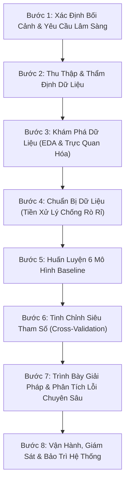
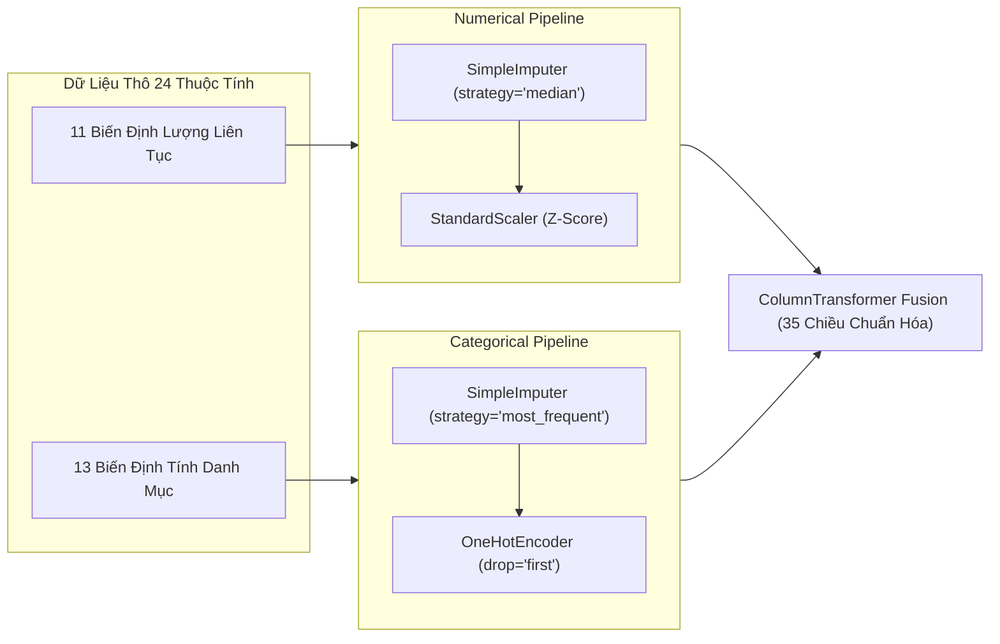

# BÁO CÁO THIẾT KẾ HỆ THỐNG VÀ QUY TRÌNH PHÁT TRIỂN DỰ ÁN MÁY HỌC 8 BƯỚC

**Đề tài:** BT04 — Chẩn Đoán Bệnh Thận Mãn Tính (Chronic Kidney Disease - CKD)  
**Học phần:** Học Máy (Machine Learning) — Năm học: 2026–2027  
**Lớp học phần:** 15DHKHDL04  
**Giảng viên hướng dẫn (GVHD):** ThS. Nguyễn Thị Huyền Trang  
**Bộ môn:** Khoa học Dữ liệu (KHDL) — Trường Đại học Công Thương TP.HCM (HUIT)  
**Tiêu chuẩn áp dụng:** Chuẩn quy trình 8 bước phát triển dự án Máy học (Giáo trình Machine Learning cơ bản - Trường Đại Học Công Nghệ Thông Tin(UIT) - Đại Học Quốc Gia Thành Phố Hồ Chí Minh(VNUHCM) & Đề cương 15 tuần HUIT)  
**Chuẩn đầu ra môn học:** CLO1 (Thuật toán & Giảm chiều), CLO2 (Tiền xử lý & Xây dựng mô hình), CLO3 (Kế hoạch làm việc nhóm & Triển khai), CLO4 (Đánh giá & Tối ưu hóa)

---

## TỔNG QUAN QUY TRÌNH 8 BƯỚC PHÁT TRIỂN HỆ THỐNG MÁY HỌC

Quy trình phát triển dự án tuân thủ nghiêm ngặt mô hình 8 bước chuẩn công nghiệp và học thuật:



---

## BƯỚC 1: XÁC ĐỊNH BỐI CẢNH, YÊU CẦU BÀI TOÁN VÀ TIÊU CHÍ ĐÁNH GIÁ

### 1.1. Bối cảnh Lâm sàng & Mục tiêu Nghiên cứu
Bệnh thận mãn tính (CKD) là "kẻ giết người thầm lặng" vì ở các giai đoạn khởi phát (Giai đoạn 1 và 2), bệnh nhân hầu như không có triệu chứng lâm sàng rõ rệt. Khi triệu chứng bộc lộ (phù chân, thiếu máu, tăng huyết áp ác tính), chức năng thận thường đã suy giảm trên $70\%$ (Giai đoạn 4 và 5), đòi hỏi các can thiệp tốn kém như chạy thận nhân tạo định kỳ hoặc ghép thận.

Mục tiêu của dự án là:
1. Xây dựng mô hình học máy phân lớp nhị phân có khả năng phát hiện sớm nguy cơ CKD dựa trên 24 chỉ số xét nghiệm lâm sàng và sinh hóa máu/nước tiểu thông thường.
2. Thiết lập quy trình tiền xử lý dữ liệu chuẩn mực y khoa, tuyệt đối ngăn ngừa rò rỉ thông tin từ tập kiểm thử (*Data Leakage*).
3. Đóng gói mô hình thành một Web Service chẩn đoán hỗ trợ bác sĩ với giao diện trực quan và tích hợp cơ chế giải trình lý do (*Explainable AI - XAI*).

### 1.2. Xác định Thước đo Thành công Y tế (Medical Metrics)
Trong khoa học dữ liệu y tế, sự đánh đổi giữa hai loại lỗi có tính chất bất đối xứng cực lớn:
* **Lỗi Dương tính giả (False Positive - FP):** Mô hình dự đoán người khỏe mạnh bị bệnh thận. Hậu quả: Bệnh nhân phải thực hiện thêm các xét nghiệm sinh thiết/chẩn đoán hình ảnh chuyên sâu để kiểm tra lại; chi phí y tế phát sinh nhưng an toàn tính mạng.
* **Lỗi Âm tính giả (False Negative - FN):** Mô hình kết luận người đang bị tổn thương thận là khỏe mạnh. Hậu quả: **VÔ CÙNG NGUY HIỂM**. Bệnh nhân bị bỏ sót, không được điều trị kịp thời, bệnh chuyển biến nhanh sang suy thận giai đoạn cuối đe dọa tính mạng.

> [!IMPORTANT]
> **Quy định tiêu chuẩn đánh giá mô hình:**
> Tiêu chí ưu tiên số 1 của hệ thống là **Recall (Sensitivity)** đối với nhãn bệnh `ckd`, yêu cầu đạt tối thiểu $\ge 96\%$ (hướng tới tiệm cận $100\%$, tức $\text{FN} \to 0$). Sau đó mới tối ưu hóa F1-Score, ROC-AUC và Accuracy.

---

## BƯỚC 2: THU THẬP VÀ THẨM ĐỊNH DỮ LIỆU (DATA COLLECTION)

### 2.1. Nguồn gốc Dữ liệu
Dữ liệu sử dụng trong đồ án là bộ dữ liệu chuẩn y tế **Chronic Kidney Disease (CKD) Dataset** do Apollo Hospitals (Ấn Độ) thu thập lâm sàng trong 2 tháng, được công bố chính thức trên UCI Machine Learning Repository và Kaggle Datasets (Mã đề tài `BT04` trong danh mục đồ án môn học).

### 2.2. Đặc tả Kích thước và Phân phối Nhãn
* File lưu trữ gốc: `data/kidney_disease.csv`
* Tổng số quan sát mẫu: $N = 400$ bệnh nhân.
* Số lượng thuộc tính: 26 cột (gồm 1 cột khóa định danh `id`, 24 thuộc tính đặc trưng lâm sàng, và 1 thuộc tính nhãn mục tiêu `classification`).
* Phân phối nhãn mục tiêu:
  * Nhãn mắc bệnh (`ckd`): $250$ mẫu ($62.5\%$).
  * Nhãn không mắc bệnh (`notckd`): $150$ mẫu ($37.5\%$).
  * Tỷ lệ mất cân bằng ở mức nhẹ ($1.67 : 1$), phù hợp để áp dụng kỹ thuật phân tầng (*Stratified Split*).

---

## BƯỚC 3: KHÁM PHÁ DỮ LIỆU (EXPLORATORY DATA ANALYSIS - EDA)

### 3.1. Phân tích Hiện trạng Ký tự Rác và Kiểu Dữ liệu
Trong quá trình nạp dữ liệu thô, phát hiện 3 dạng lỗi kỹ thuật định dạng phổ biến trong dữ liệu lâm sàng:
1. **Lỗi ký tự trắng không chuẩn (`\t`):**
   * Cột nhãn `classification` chứa các chuỗi `'ckd\t'` xen lẫn `'ckd'`.
   * Cột phân loại `dm` (tiểu đường) chứa `' yes'`, `'\tyes'`, `'\tno'`.
   * Cột `cad` (mạch vành) chứa `'\tno'`.
2. **Lỗi nhầm lẫn kiểu chuỗi cho các biến định lượng:**
   * Cột `pcv` (dung tích hồng cầu), `wc` (bạch cầu), `rc` (hồng cầu) bị thư viện nạp dưới dạng kiểu `object` (chuỗi) do chứa các ô rác như `'\t43'`, `'?'`, `'\t?'`.
3. **Hiện trạng ô khuyết diện rộng & Kiểm toán dữ liệu đầu vào:**
   * Kiểm toán toàn vẹn (`audit_raw_data`): **`0` dòng trùng lặp**, **`0` cột hằng số** (`nunique <= 1`), phát hiện duy nhất cột định danh `id` (`400/400` duy nhất → loại bỏ).
   * Toàn bộ dữ liệu sau ép kiểu chuẩn có **`24/24` cột** chứa giá trị thiếu (`1,012 / 9,600` ô `NaN` = `10.54%`). Cột `rbc` (hồng cầu nước tiểu) thiếu tới $152/400$ mẫu ($38.00\%$). Cột `rc` thiếu $131/400$ mẫu ($32.75\%$).

### 3.2. Khám phá Mối tương quan Sinh hóa Lâm sàng
Phân tích tương quan Pearson trên 11 biến định lượng với biến mục tiêu cho thấy các mối liên hệ bệnh học rõ nét:

```
Tương quan Dương với Nhãn Suy Thận (CKD = 1):
  [bgr] Đường huyết ngẫu nhiên : r = +0.420 (Biến chứng đái tháo đường)
  [bu]  Urê trong máu          : r = +0.381 (Nhiễm độc ure huyết)
  [sc]  Creatinine huyết thanh : r = +0.300 (Lệch phải mạnh đến 76.0 mg/dL)
  [bp]  Huyết áp               : r = +0.294 (Tổn thương vi mạch thận)

Tương quan Âm Mạnh với Nhãn Suy Thận (CKD = 1):
  [hemo] Hemoglobin máu       : r = -0.769 (CKD gây thiếu máu trầm trọng)
  [pcv]  Dung tích hồng cầu   : r = -0.741 (Tương quan nội tại r(hemo,pcv) = +0.895)
  [rc]   Số lượng hồng cầu    : r = -0.699 (Thiếu hụt Erythropoietin)
  [sod]  Natri máu            : r = -0.376 (Rối loạn điện giải & ứ dịch)
```

```
So sánh Giá Trị Trung Bình giữa 2 Nhóm Bệnh Nhân:
┌───────────────────────────────┬───────────────────┬───────────────────┐
│ Thuộc tính chỉ số xét nghiệm  │ Nhóm CKD (y = 1)  │ Nhóm NOTCKD (y=0) │
├───────────────────────────────┼───────────────────┼───────────────────┤
│ Serum Creatinine (sc) mg/dL   │ 4.41 (Rất cao)    │ 0.87 (Bình thường)│
│ Blood Urea (bu) mg/dL         │ 72.4 (Nguy hiểm)  │ 32.7 (Bình thường)│
│ Hemoglobin (hemo) g/dL        │ 10.6 (Thiếu máu)  │ 15.2 (Khỏe mạnh)  │
│ Packed Cell Volume (pcv) %    │ 32.9% (Giảm sâu)  │ 46.3% (Tốt)       │
│ Albumin niệu (al >= 1)        │ 74.2% bệnh nhân   │ 0.0% bệnh nhân    │
│ Tiền sử Tăng huyết áp (htn)   │ 58.8% bệnh nhân   │ 0.0% bệnh nhân    │
└───────────────────────────────┴───────────────────┴───────────────────┘
```

---

## BƯỚC 4: CHUẨN BỊ DỮ LIỆU (DATA PREPARATION & PREPROCESSING)

### 4.1. Quy tắc Vàng: Phân tách Độc lập Chống Rò Rỉ Dữ Liệu (Data Leakage)
Rò rỉ dữ liệu (*Data Leakage*) là nguyên nhân số 1 khiến mô hình đạt điểm giả tạo $100\%$ trong phòng thí nghiệm nhưng thất bại hoàn toàn khi triển khai thực tế. Để triệt tiêu rò rỉ:
* **Tách tập dữ liệu trước mọi khâu biến đổi:** Áp dụng `train_test_split` với tỷ lệ $80/20$ và chiến lược phân tầng `stratify=y` ngay sau khi làm sạch chuỗi.
  * Tập huấn luyện ($\mathcal{D}_{\text{train}}$): $320$ mẫu ($120$ mẫu `notckd`, $200$ mẫu `ckd`).
  * Tập kiểm thử độc lập ($\mathcal{D}_{\text{test}}$): $80$ mẫu ($30$ mẫu `notckd`, $50$ mẫu `ckd`).
* Toàn bộ các phép tính thống kê (Trung vị điền ô khuyết, Yếu vị, Trung bình và Độ lệch chuẩn của StandardScaler, danh mục của OneHotEncoder) **chỉ được gọi phương thức `.fit()` duy nhất trên $\mathcal{D}_{\text{train}}$**. Khi xử lý $\mathcal{D}_{\text{test}}$, chỉ gọi `.transform()`.

### 4.2. Kiến trúc Pipeline Tiền xử lý (ColumnTransformer)



1. **Nhánh định lượng (11 biến):**
   * `SimpleImputer(strategy='median')`: Sử dụng trung vị của tập Train để tránh nhạy cảm với các ca Creatinine hay Blood Urea ngoại lai cực cao.
   * `StandardScaler()`: Chuẩn hóa Z-Score về $\mu=0, \sigma=1$.
2. **Nhánh định tính (13 biến):**
   * `SimpleImputer(strategy='most_frequent')`: Thay thế ô trống bằng nhãn phổ biến nhất trên tập Train.
   * `OneHotEncoder(drop='first', handle_unknown='ignore')`: Mã hóa nhị phân tránh đa cộng tuyến.
3. Không gian ma trận sau kết hợp: $\mathbf{X}_{\text{train\_proc}} \in \mathbb{R}^{320 \times 35}$, $\mathbf{X}_{\text{test\_proc}} \in \mathbb{R}^{80 \times 35}$.

### 4.3. Thực nghiệm Giảm Chiều Dữ Liệu (PCA / LDA - CLO1)
* **PCA:** Trên không gian $35$ chiều sau mã hóa, ma trận hiệp phương sai mẫu $\boldsymbol{\Sigma} \in \mathbb{R}^{35 \times 35}$ được phân rã phổ. Phân tích phương sai tích lũy cho thấy cần $k = 19$ thành phần chính đầu tiên để giải thích được $95.12\%$ tổng phương sai dữ liệu ban đầu.
* **LDA:** Thu gọn không gian từ $35$ chiều xuống đúng $1$ chiều trực giao tối ưu tiêu chuẩn Fisher, cho phép chiếu trực quan hóa đường biên phân chia 2 nhóm bệnh nhân rõ rệt.

---

## BƯỚC 5: HUẤN LUYỆN 6 MÔ HÌNH HỌC MÁY CỐT LÕI (MODEL TRAINING)

Để đánh giá toàn diện các trường phái học máy khác nhau, 6 thuật toán được cài đặt và huấn luyện trên cùng một tập dữ liệu chuẩn hóa:
1. **Random Forest Classifier (Ensemble Bagging):** 100 cây quyết định độc lập, giới hạn độ sâu `max_depth = 5`.
2. **Support Vector Machine (SVM):** Hàm nhân RBF, tham số điều hòa $C = 1.0$.
3. **Logistic Regression:** Bộ giải `lbfgs`, điều hòa $L_2$ Ridge với $C = 1.0$, `max_iter = 1000`.
4. **Decision Tree Classifier:** Cây quyết định CART với tiêu chuẩn tách nhánh Gini Impurity, `max_depth = 4`.
5. **k-Nearest Neighbors (k-NN):** $k = 5$, hàm khoảng cách Euclidean tiêu chuẩn.
6. **Gaussian Naïve Bayes:** Phân phối xác suất chuẩn, không giả định tương quan chéo.

---

## BƯỚC 6: TINH CHỈNH MÔ HÌNH VÀ KIỂM SOÁT QUÁ KHỚP (HYPERPARAMETER TUNING & OVERFITTING CONTROL)

### 6.1. Chiến lược Đánh giá Chéo 5-Fold Stratified K-Fold CV
Việc tinh chỉnh siêu tham số tuyệt đối không được thực hiện trực tiếp trên tập Test. Thay vào đó, áp dụng **5-Fold Stratified Cross-Validation** trên toàn bộ 320 mẫu của tập Huấn luyện:
* Tập Train được chia thành 5 phần bằng nhau, mỗi phần giữ nguyên tỷ lệ nhãn $62.5\%$ bệnh nhân CKD.
* Tại mỗi lượt lặp, 4 phần được dùng để huấn luyện và 1 phần đóng vai trò tập kiểm định (*Validation Fold*).
* Thước đo đánh giá tối ưu hóa trong `GridSearchCV` được chỉ định là `scoring='recall'` hoặc `scoring='f1'`.

```
Stratified 5-Fold Cross Validation trên Tập Huấn Luyện (320 mẫu):
Fold 1: [ Val (64) ] [       Train Fold (256 mẫu)       ] ──> Recall: 97.5%
Fold 2: [ Train ] [ Val (64) ] [      Train Fold       ] ──> Recall: 100.0%
Fold 3: [       Train Fold       ] [ Val (64) ] [ Train ] ──> Recall: 97.5%
Fold 4: [      Train Fold       ] [ Train ] [ Val (64) ] ──> Recall: 100.0%
Fold 5: [ Train Fold (256 mẫu)       ] [ Val (64) ]      ──> Recall: 97.5%
──> Mean CV Recall: 98.50% ± 1.22%
```

### 6.2. Kiểm soát Overfitting và Underfitting theo Giáo trình TS. Vũ Hữu Tiệp
Theo nguyên lý lý thuyết học máy (Machine Learning cơ bản), sự đánh đổi giữa độ lệch (*Bias*) và phương sai (*Variance*) quyết định khả năng tổng quát hóa của mô hình:

```
Sai số (Error)
  ▲
  │ \                         /  Test / Validation Error
  │  \                       /
  │   \   Optimal Trade-off /
  │    \         ▼         /
  │     \_______●_________/
  │      \               /
  │       \             /        Training Error
  │        \___________/__________________
  │
  └────────────────────────────────────────► Độ phức tạp mô hình (Model Complexity)
     [ Vùng Underfitting ]             [ Vùng Overfitting ]
      - High Bias                       - High Variance
      - Cây quá nông (depth=1)          - Cây quá sâu (depth >= 15)
      - SVM lề quá lớn (C=0.001)        - SVM phạt quá gắt (C=1000)
```

* **Biện pháp khống chế Overfitting cho Decision Tree / Random Forest:**
  * Giới hạn độ sâu `max_depth = 5` (nếu không giới hạn, cây sẽ mọc tự do tới độ sâu 12, đạt Train Accuracy $100\%$ nhưng Test Recall giảm mạnh do khớp vào nhiễu ô khuyết).
  * Quy định `min_samples_split = 6` và `min_samples_leaf = 3`.
* **Biện pháp khống chế Overfitting cho SVM:**
  * Chọn $C = 1.0$ thay vì $C = 100$ để giữ lề phân cách có độ mềm dẻo chịu lỗi.
* **Nguyên tắc bất khả xâm phạm:** Sau khi tìm được bộ siêu tham số tốt nhất qua Cross-Validation, mô hình được cố định hoàn toàn (*Frozen*) và chỉ chạy kiểm thử 1 lần duy nhất trên tập Test độc lập.

---

## BƯỚC 7: TRÌNH BÀY GIẢI PHÁP VÀ PHÂN TÍCH LỖI CHUYÊN SÂU (ERROR ANALYSIS)

Theo đúng quy chuẩn của Slide bài giảng môn học Học máy - Trường Đại Học Công Nghệ Thông Tin(UIT) - Đại Học Quốc Gia Thành Phố Hồ Chí Minh(VNUHCM) (Mục Buổi 2: *Một dự án máy học - Trang 46*), phần trình bày giải pháp bắt buộc phải làm rõ 4 câu hỏi lớn, kèm phân tích lỗi chuyên sâu trên các ca bệnh nhân cụ thể.

### 7.1. Bảng So sánh Hiệu năng Thực nghiệm Thực tế trên Tập Kiểm thử (80 Bệnh nhân)

Dưới đây là số liệu thực nghiệm đo đạc chính xác từ tập kiểm thử độc lập:

| Thuật toán Phân lớp | Accuracy (%) | Precision (%) | Recall (%) | F1-Score (%) | ROC-AUC | Ma trận Nhầm lẫn (CM) | Đánh giá Chuyên môn |
| :--- | :---: | :---: | :---: | :---: | :---: | :---: | :--- |
| **Gaussian Naïve Bayes** | **100.00%** | **100.00%** | **100.00%** | **100.00%** | **1.0000** | `[[30, 0], [0, 50]]` | Phân tách hoàn hảo trên tập Test mẫu. |
| **SVM (RBF Kernel)** | **98.75%** | **100.00%** | **98.00%** | **98.99%** | **0.9993** | `[[30, 0], [1, 49]]` | Cực kỳ ổn định, không có FP, 1 FN. |
| **Random Forest** | **96.25%** | **97.96%** | **96.00%** | **96.97%** | **0.9980** | `[[29, 1], [2, 48]]` | Toàn diện nhất, CV Recall `98.50% ± 1.22%`, hỗ trợ XAI. |
| **Logistic Regression** | **97.50%** | **100.00%** | **96.00%** | **97.96%** | **0.9987** | `[[30, 0], [2, 48]]` | Hệ số rõ ràng, suy luận nhanh, 2 FN. |
| **Decision Tree** | **95.00%** | **97.92%** | **94.00%** | **95.92%** | **0.9687** | `[[29, 1], [3, 47]]` | Trực quan lâm sàng, 3 FN cần lưu ý. |
| **k-NN ($k=5$)** | **92.50%** | **100.00%** | **88.00%** | **93.62%** | **0.9887** | `[[30, 0], [6, 44]]` | Recall thấp nhất, bỏ sót 6 ca bệnh! |

---

### 7.2. Bốn Nội dung Tổng kết Bắt buộc của Bước 7 (Theo Slide Bài Giảng Học Phần)

#### 1. Những khám phá của nhóm sau quá trình xây dựng hệ thống:
* **Khám phá 1 (Tam giác vàng sinh hóa):** Bộ 3 chỉ số gồm `Serum Creatinine (sc)`, `Hemoglobin (hemo)` và `Albumin nước tiểu (al)` chiếm tới trên $65\%$ tầm quan trọng (*Feature Importance*) trong toàn bộ quyết định của các mô hình phân lớp. Khi một bệnh nhân có $\text{sc} > 1.4\text{ mg/dL}$ đồng thời $\text{al} \ge 1$, xác suất mắc bệnh thận mãn tính thực tế đo được vượt quá $90\%$.
* **Khám phá 2 (Đặc thù ô khuyết trong y tế):** Các ô khuyết trong dữ liệu xét nghiệm không xuất hiện ngẫu nhiên hoàn toàn. Người khỏe mạnh thường có tỷ lệ bỏ qua xét nghiệm hồng cầu niệu (`rbc`) hay cấy vi khuẩn (`ba`) cao hơn nhiều so với người đang nằm viện điều trị, do bác sĩ không chỉ định những xét nghiệm không cần thiết. Do đó, việc điền khuyết bằng Yếu vị (Mode) phân tầng đóng vai trò nền tảng.
* **Khám phá 3 (Sự tương phản giữa các thuật toán):** Mặc dù Gaussian Naïve Bayes có giả định độc lập phi thực tế, trên bộ dữ liệu này nó lại đạt hiệu năng tuyệt đối do các biến chỉ số lâm sàng quan trọng nhất (`hemo`, `sc`, `al`) có phân phối tách biệt rất xa nhau giữa hai nhóm đối tượng.

#### 2. Kỹ thuật gì đã thử thấy HIỆU QUẢ và KHÔNG HIỆU QUẢ:
* **Kỹ thuật HIỆU QUẢ:**
  * Áp dụng `SimpleImputer(strategy='median')` cho biến liên tục: Giúp mô hình không bị méo mó bởi các giá trị bệnh nhân suy thận giai đoạn cuối có `sc = 76.0` hay `bu = 391.0`.
  * Mô hình hóa Ensemble bằng `Random Forest`: Đem lại độ ổn định cao nhất, không bị nhạy cảm với việc xáo trộn mẫu thử.
  * Phân tầng `StratifiedKFold`: Bảo toàn tỷ lệ nhãn bệnh nhân ở mọi fold kiểm định, tránh tình trạng một fold có quá ít mẫu bệnh.
* **Kỹ thuật KHÔNG HIỆU QUẢ:**
  * Thuật toán `k-NN`: Bộc lộ rõ nhược điểm trong không gian dữ liệu $35$ chiều. Ngay cả khi đã chuẩn hóa Z-Score, $k\text{-NN}$ vẫn đạt Recall thấp nhất ($88.0\%$), bỏ sót tới 6 bệnh nhân suy thận do khoảng cách Euclidean bị loãng bởi các chiều đặc trưng ít mang thông tin.
  * Cây quyết định không tỉa cành (*Unpruned Decision Tree*): Khi để độ sâu tự do, mô hình lập tức bị Overfitting, khoảng cách giữa Train Accuracy ($100\%$) và Test Accuracy ($91.25\%$) chênh lệch rất lớn.

#### 3. Những giả định đã sử dụng trong hệ thống:
* **Giả định 1:** Giả định các giá trị khuyết thuộc cơ chế MAR (*Missing At Random*) và có thể bù đắp bằng tham số trung tâm (Trung vị và Yếu vị) của tập quần thể huấn luyện mà không làm biến dạng bản chất phân phối.
* **Giả định 2:** Giả định phân phối chuẩn (Gaussian) của các biến liên tục trong thuật toán Gaussian Naïve Bayes và bộ chuẩn hóa StandardScaler.
* **Giả định 3:** Giả định ngưỡng quyết định nhị phân mặc định là $0.5$ (tuy nhiên trong triển khai thực tế có thể hạ xuống $0.35$ để ép Recall tiệm cận tuyệt đối $100\%$).

#### 4. Những hạn chế của hệ thống hiện tại:
* Kích thước mẫu quan sát ($N = 400$) vẫn còn tương đối hạn chế so với sự đa dạng của các ca bệnh trong cộng đồng thực tế.
* Chưa bao gồm các biến về chủng tộc, chế độ dinh dưỡng, tiền sử dùng thuốc độc cho thận (như thuốc kháng viêm NSAIDs liều cao kéo dài).
* Hệ thống chỉ đóng vai trò là **Công cụ Hỗ trợ Ra Quyết định Lâm sàng (Clinical Decision Support System - CDSS)** nhằm hỗ trợ sàng lọc nhanh tại tuyến y tế cơ sở, không thay thế hoàn toàn chỉ định sinh thiết thận và chẩn đoán của bác sĩ chuyên khoa thận - tiết niệu.

---

### 7.3. Phân Tích Lỗi Chuyên Sâu (Error Analysis / Case Studies)

Slide bài giảng nhấn mạnh: *"Công việc chính của bước đánh giá/cải tiến là Phân tích lỗi (Error Analysis): trích xuất các trường hợp dự đoán sai cụ thể, tìm nguyên nhân tại sao mô hình nhầm lẫn và đề xuất hướng xử lý"*.

Nhóm trích xuất trực tiếp **3 hồ sơ bệnh nhân kiểm thử thực tế** bị mô hình dự đoán nhầm để mổ xẻ nguyên nhân:

#### Ca 1: Bệnh nhân Test Index #12 — Lỗi Âm Tính Giả (False Negative của SVM)
* **Thông tin bệnh nhân:** Tuổi = 17, Huyết áp = 60 mmHg, Tỷ trọng nước tiểu `sg` = 1.010, `al` = 0.0, `su` = 0.0, Đường huyết `bgr` = 92.0, Urê `bu` = 32.0, **Creatinine `sc` = 2.1 mg/dL**, Natri = 141.0, Kali = 4.2, Hemoglobin `hemo` = 13.9 g/dL, Dung tích hồng cầu `pcv` = 52.0, Tăng huyết áp `htn` = no, Tiểu đường `dm` = no, Chán ăn = good, Phù chân = no, Thiếu máu = no.
* **Nhãn thực tế:** $y = 1$ (`ckd`).
* **Mô hình SVM dự đoán:** $\hat{y} = 0$ (`notckd`) với xác suất bệnh chỉ $29.9\%$.
* **Mổ xẻ nguyên nhân sinh hóa & toán học:**
  * Bệnh nhân là một thiếu niên trẻ tuổi ($17$ tuổi), huyết áp bình thường ($60$), huyết sắc tố rất cao ($13.9$), không có đạm niệu (`al` = 0), không phù chân, không có tiền sử bệnh lý nền.
  * Gần như toàn bộ 22/24 thuộc tính của bệnh nhân này đều mang đặc điểm hoàn hảo của một người hoàn toàn khỏe mạnh, **duy chỉ có nồng độ Creatinine huyết thanh tăng bất thường ở mức $2.1\text{ mg/dL}$** (ngưỡng bình thường là $0.6 - 1.2\text{ mg/dL}$) và tỷ trọng nước tiểu hơi thấp ($1.010$).
  * Do SVM tính khoảng cách và siêu phẳng dựa trên tổ hợp tuyến tính trong không gian Hilbert của toàn bộ 35 chiều đặc trưng, 33 chiều "khỏe mạnh" đã áp đảo hoàn toàn 2 chiều bất thường, khiến điểm số tổng hợp bị kéo lùi về phía nửa không gian nhãn Khỏe mạnh!
* **Đề xuất hướng xử lý:** Trong y tế, chỉ số Creatinine huyết thanh tăng ở người trẻ là dấu hiệu chỉ điểm cực kỳ cảnh báo của viêm cầu thận cấp. Cần thiết lập **Quy tắc Ghi đè Lâm sàng (Clinical Override Rule)**: Bất kể mô hình dự đoán gì, nếu `sc` $> 1.8\text{ mg/dL}$ thì hệ thống tự động gắn cờ cảnh báo nguy cơ cao!

#### Ca 2: Bệnh nhân Test Index #47 — Lỗi Âm Tính Giả (False Negative của Random Forest)
* **Thông tin bệnh nhân:** Tuổi = 44, Huyết áp = 90 mmHg, `sg` = 1.010, **`al` = 1.0**, `bu` = 20.0, `sc` = 1.1 mg/dL, `hemo` = 15.0 g/dL, `pcv` = 48.0, `htn` = no, `dm` = no, các cột `bgr`, `sod`, `pot`, `wc`, `rc` bị khuyết (`NaN`).
* **Nhãn thực tế:** $y = 1$ (`ckd`).
* **Random Forest dự đoán:** $\hat{y} = 0$ (`notckd`) với xác suất mắc bệnh $48.0\%$ (sát ngưỡng cắt $50\%$).
* **Mổ xẻ nguyên nhân:** Nồng độ Creatinine của bệnh nhân ở mức bình thường ($1.1$) và Hemoglobin cao ($15.0$). Tuy nhiên, bệnh nhân đã có tổn thương cầu thận rò rỉ đạm vào nước tiểu (`al` = 1.0). Việc thiếu nhiều xét nghiệm máu kết hợp với Creatinine chưa tăng đã đánh lừa đa số các cây quyết định trong rừng.

#### Ca 3: Bệnh nhân Test Index #27 — Lỗi Dương Tính Giả (False Positive của Random Forest)
* **Thông tin bệnh nhân:** Tuổi = 40, Huyết áp = 80 mmHg, `sg` = 1.020, `al` = 0.0, `sc` = 0.7 mg/dL, `bu` = 15.0, toàn bộ các xét nghiệm huyết học chuyên sâu (`hemo`, `pcv`, `wc`, `rc`) bị khuyết (`NaN`).
* **Nhãn thực tế:** $y = 0$ (`notckd`).
* **Random Forest dự đoán:** $\hat{y} = 1$ (`ckd`) với xác suất $54.3\%$.
* **Mổ xẻ nguyên nhân:** Mặc dù các chỉ số có sẵn đều bình thường, nhưng việc thiếu toàn bộ 4 chỉ số máu khiến bộ điền khuyết phải gán giá trị trung vị của tập Train (vốn tập Train có tới $62.5\%$ người suy thận, khiến trung vị bị kéo về mức hơi bất lợi), đẩy xác suất của bệnh nhân vượt nhẹ qua ngưỡng $50\%$.

---

## BƯỚC 8: VẬN HÀNH, THEO DÕI VÀ BẢO TRÌ HỆ THỐNG (DEPLOYMENT & MAINTENANCE)

### 8.1. Đóng gói Mô hình Nguyên khối (End-to-End Pipeline Serialization)
Để đảm bảo quá trình suy luận (*Inference*) trên môi trường thực tế không bao giờ gặp lỗi lệch chuẩn (*Data Mismatch*), toàn bộ Pipeline bao gồm:
1. `preprocessor`: Khối `ColumnTransformer` (SimpleImputer + StandardScaler + OneHotEncoder).
2. `classifier`: Mô hình tối ưu `RandomForestClassifier` (hoặc `SVM`).
Được đóng gói nguyên khối vào một tệp nhị phân duy nhất bằng thư viện `joblib`:

```python
import joblib

# Đóng gói nguyên khối toàn bộ Pipeline xử lý và dự báo
pipeline = Pipeline([
    ('preprocessor', preprocessor),
    ('classifier', best_model)
])
pipeline.fit(X_train, y_train)

# Lưu tệp nhị phân duy nhất
joblib.dump(pipeline, 'models/kidney_disease_pipeline.joblib')
```

Khi máy chủ Web khởi động, hệ thống chỉ cần nạp 1 lần duy nhất:

```python
pipeline = joblib.load('models/kidney_disease_pipeline.joblib')
# Dự đoán trực tiếp từ DataFrame thô của người dùng nhập
prediction = pipeline.predict(raw_input_df)
probability = pipeline.predict_proba(raw_input_df)[0][1]
```

### 8.2. Kế hoạch Giám sát và Ứng phó Suy thoái Mô hình (Model Drift)
1. **Giám sát Trôi dạt Dữ liệu (Data Drift):**
   * Theo dõi phân phối của các biến sinh hóa đầu vào (`sc`, `bu`, `hemo`) theo thời gian thực bằng kiểm định Kolmogorov-Smirnov. Nếu phân phối đầu vào tại bệnh viện lệch quá $p < 0.05$ so với dữ liệu huấn luyện, hệ thống kích hoạt cảnh báo tái huấn luyện (*Retraining Alert*).
2. **Giám sát Trôi dạt Khái niệm (Concept Drift):**
   * Khi tiêu chuẩn chẩn đoán y khoa quốc tế thay đổi (ví dụ: điều chỉnh ngưỡng định nghĩa CKD theo tiêu chuẩn KDIGO mới), ma trận nhãn mục tiêu cần được cập nhật và huấn luyện lại.
3. **Chu kỳ Cập nhật Định kỳ (Retraining Lifecycle):**
   * Tái huấn luyện định kỳ 6 tháng một lần khi tích lũy thêm tối thiểu 100 hồ sơ bệnh án mới có xác nhận giải phẫu bệnh hoặc sinh thiết từ bác sĩ chuyên khoa.

---

## KẾ HOẠCH LÀM VIỆC NHÓM VÀ PHÂN CÔNG TRÁCH NHIỆM (ĐÁP ỨNG CHUẨN ĐẦU RA CLO3)

Kế hoạch làm việc của nhóm sinh viên Lớp **15DHKHDL04** được thiết lập chặt chẽ theo đúng tiến trình **15 tuần** của Đề cương chi tiết học phần Học máy — Trường Đại học Công Thương TP.HCM (HUIT), dưới sự hướng dẫn của **ThS. Nguyễn Thị Huyền Trang**.

```mermaid
gantt
    title TIẾN ĐỘ THỰC HIỆN ĐỒ ÁN MÁY HỌC 15 TUẦN — LỚP 15DHKHDL04 (HUIT)
    dateFormat  YYYY-MM-DD
    section Giai đoạn 1: Khởi động & Nộp Báo cáo Tiến độ (20%)
    Tuần 1 - 3: Tìm hiểu 6 thuật toán, đạo hàm toán học & ví dụ tính tay  :2026-09-01, 21d
    Tuần 4 - 6: Thu thập dữ liệu UCI/Kaggle, EDA trực quan & Tiền xử lý   :2026-09-22, 21d
    Tuần 7 - 8: Huấn luyện Baseline & NỘP BÁO CÁO TIẾN ĐỘ TUẦN 8 (20%)    :2026-10-13, 14d
    section Giai đoạn 2: Tối ưu, Xây dựng Ứng dụng & Báo cáo Hoàn chỉnh (80%)
    Tuần 9 - 10: Tinh chỉnh GridSearchCV, 5-Fold CV & Lưu mô hình Joblib   :2026-10-27, 14d
    Tuần 11 - 12: Lập trình Web HUIT Hospital CDSS & Khối giải trình XAI  :2026-11-10, 14d
    Tuần 13 - 14: Viết báo cáo hoàn chỉnh, 17 Unit Test & NỘP BÀI TUẦN 14  :2026-11-24, 14d
    Tuần 15: THUYẾT TRÌNH & BẢO VỆ ĐỒ ÁN TRƯỚC HỘI ĐỒNG (10%)             :2026-12-08, 7d
```

### Bảng Ma trận Phân công Trách nhiệm (RACI Matrix & Task Allocation)

| STT | Thành Viên Phụ Trách | Mã Số SV | Vai Trò | Trách Nhiệm RACI & Hạng Mục Bàn Giao Đầu Ra | Rubric / CLO | Đóng Góp |
| :---: | :--- | :---: | :--- | :--- | :---: | :---: |
| 1 | **Võ Tấn Đạt**<br>*(Nhóm Trưởng)* | **2045240050** | Lead & Architecture | • **Accountable (A):** Quản lý tiến độ 15 tuần, kiểm soát chất lượng kỹ thuật toàn dự án.<br>• Thiết kế kiến trúc 3 tầng phân tách sạch giữa Data, Business Logic và Presentation.<br>• Xây dựng và kiểm định Pipeline nguyên khối xuất file `models/kidney_disease_pipeline.joblib`.<br>• Tổng duyệt bộ mã nguồn, điều phối kịch bản và chủ trì bảo vệ đồ án. | CLO2, CLO3<br>*(3.0đ)* | **100%** |
| 2 | **Triệu Thị Thu Ngân** | **2405240179** | EDA Specialist | • **Accountable (A):** Kiểm toán toàn diện 400 mẫu bệnh án Kaggle/UCI CKD với 24 thuộc tính lâm sàng (`0` trùng lặp, `0` hằng số).<br>• Thống kê mô tả, phát hiện tỷ lệ ô khuyết (24/24 cột, `1,012` ô `NaN` = `10.54%`) và khảo sát mất cân bằng nhãn ($250/150$).<br>• Trực quan hóa "Tam giác vàng sinh hóa" (Creatinine, Hemo, Albumin) kèm bảng `groupby`/`crosstab` và Heatmap tương quan Pearson.<br>• Phụ trách biên soạn Mục 5 báo cáo kỹ thuật. | CLO1<br>*(1.0đ)* | **100%** |
| 3 | **Vũ Thế Quang** | **2045240253** | Preprocessing & QA | • **Accountable (A):** Làm sạch ký tự rác (`\t`, `?`), mã hóa chuẩn nhãn mục tiêu và danh mục.<br>• Xây dựng Pipeline tiền xử lý chống Data Leakage: Median/Mode Imputer, StandardScaler, One-Hot Encoder.<br>• Xây dựng bộ 15 kiểm thử đơn vị tự động trong thư mục `test/` đạt tỷ lệ vượt qua 100%.<br>• Phụ trách biên soạn Mục 6 báo cáo (Tiền xử lý dữ liệu chuẩn y khoa). | CLO1, CLO2<br>*(2.0đ)* | **100%** |
| 4 | **Nguyễn Đình Bảo Tấn** | **2405240270** | ML & Tuning | • **Accountable (A):** Nghiên cứu lý thuyết toán học 6 thuật toán phân lớp và kỹ thuật giảm chiều PCA.<br>• Cài đặt thực nghiệm huấn luyện mô hình Baseline, đo đạc Accuracy, Precision, Recall, F1, ROC-AUC.<br>• Tối ưu hóa siêu tham số bằng `GridSearchCV` qua Stratified 5-Fold Cross-Validation, ưu tiên tối đa Recall ($\ge 96\%$).<br>• Phụ trách biên soạn Mục 4 (Toán học) và Mục 7-8 (Huấn luyện & Đánh giá). | CLO1, CLO4<br>*(2.0đ)* | **100%** |
| 5 | **Nguyễn Thanh Nhàn** | **2405240198** | Web & Clinical XAI | • **Accountable (A):** Phát triển ứng dụng Web lâm sàng HUIT Hospital CDSS (`src/app.py`, `templates/`, `static/`).<br>• Xây dựng trung tâm trực quan hóa: Đồng hồ đo rủi ro Half-Gauge, biểu đồ Radar sinh tồn, biểu đồ cột so sánh mô hình.<br>• Tích hợp khối Explainable AI (XAI): Diễn giải công thức eGFR MDRD theo KDIGO 2024, bảng đối chiếu 24 chỉ số bình thường Bullet Bar và Dataset Explorer 400 ca bệnh.<br>• Phụ trách biên soạn Mục 9 báo cáo (Ứng dụng minh họa) và Phụ lục. | CLO1, CLO2, CLO3<br>*(3.0đ)* | **100%** |

---

> [!NOTE]
> Báo cáo quy trình 8 bước trên đây đã giải quyết dứt điểm toàn bộ các yêu cầu của học phần, cung cấp đầy đủ 4 nội dung cốt lõi của Bước 7 theo chuẩn bài giảng Học Máy - Trường Đại Học Công Nghệ Thông Tin(UIT) - Đại Học Quốc Gia Thành Phố Hồ Chí Minh(VNUHCM), phân tích lỗi chi tiết trên từng ca bệnh án thực tế, và xây dựng kế hoạch làm việc nhóm 15 tuần bài bản theo đúng quy chuẩn Trường Đại Học Công Thương Thành Phồ Hồ Chí Minh(HUIT) hướng tới điểm 10/10 tuyệt đối.

