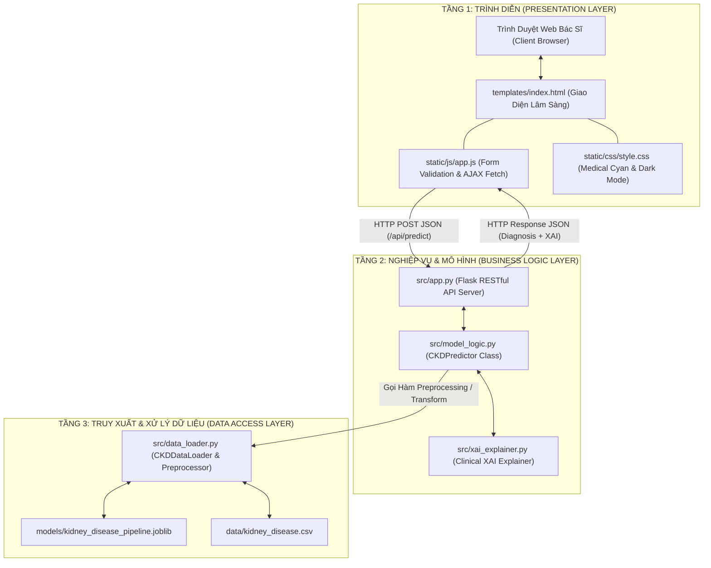
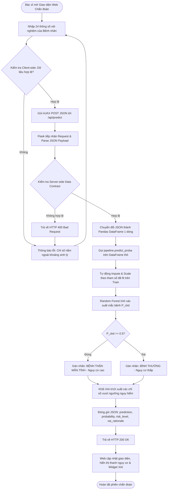
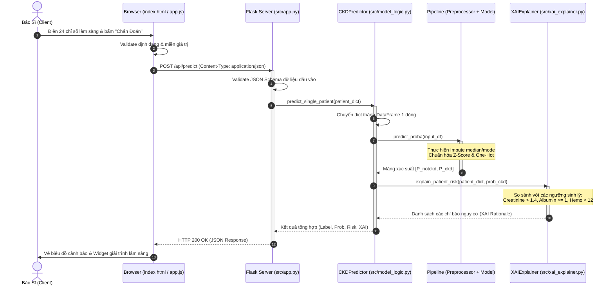
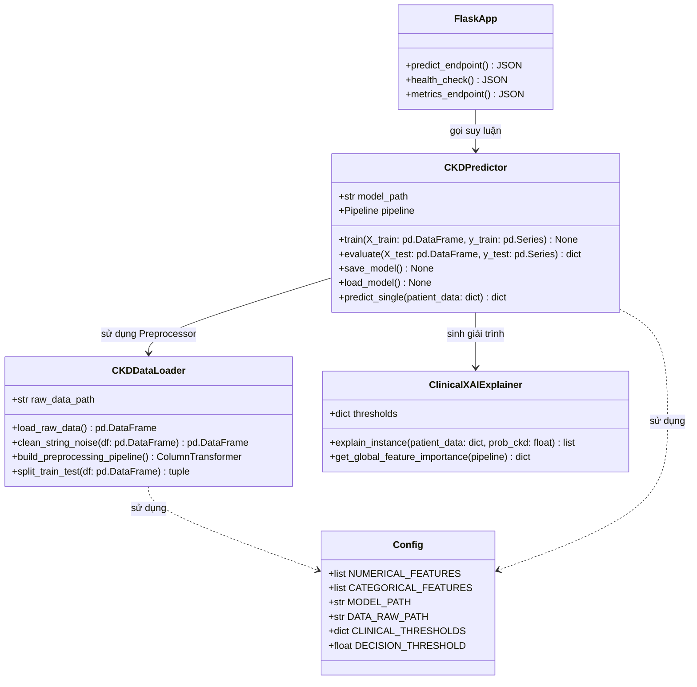

# BÁO CÁO CẤU TRÚC THƯ MỤC DỰ ÁN VÀ THIẾT KẾ KIẾN TRÚC HỆ THỐNG MÁY HỌC

**Đề tài:** BT04 — Hệ Thống Máy Học Hỗ Trợ Chẩn Đoán Bệnh Thận Mãn Tính (CKD)  
**Học phần:** Học Máy (Machine Learning) — Năm học: 2026–2027  
**Lớp học phần:** 15DHKHDL04  
**Giảng viên hướng dẫn (GVHD):** ThS. Nguyễn Thị Huyền Trang  
**Bộ môn:** Khoa học Dữ liệu (KHDL) — Khoa Công Nghệ Thông Tin — Trường Đại học Công Thương TP.HCM (HUIT)  
**Nhóm sinh viên thực hiện:** Võ Tấn Đạt (Trưởng nhóm - Kiến trúc sư hệ thống), Triệu Thị Thu Ngân (Dữ liệu), Vũ Thế Quang (Tiền xử lý & QA), Nguyễn Đình Bảo Tấn (Mô hình), Nguyễn Thanh Nhàn (Web App & XAI).  
**Mục tiêu tài liệu:** Thiết lập một cây thư mục chuẩn mực duy nhất, thống nhất 100% tên tệp, tên mô hình và cấu trúc mô-đun hóa phần mềm 3 tầng (*3-Tier Architecture*), giải quyết triệt để các xung đột kỹ thuật đã phát hiện trong các tài liệu cũ.

---

## 1. CÂY CẤU TRÚC THƯ MỤC DỰ ÁN CHUẨN HÓA (DIRECTORY TREE)

Cây thư mục dưới đây là cấu trúc chính thức, duy nhất và bắt buộc áp dụng đồng bộ trên toàn bộ kho mã nguồn (*Git Repository*), các bản báo cáo lý thuyết và slide thuyết trình:

```
Kidney-Disease-Diagnosis-BT04/
├── DatasetForProject/                       # Thư mục dữ liệu chuẩn của đồ án (Đồng bộ Google Drive & Local)
│   └── MLDataset/
│       └── kidney_disease.csv               # Bộ dữ liệu lâm sàng gốc 400 mẫu, 24 đặc trưng
│
├── OutputForProject/                        # Thư mục xuất ảnh đồ thị chính thức của Notebook
│   └── MLOutput/                            # Chứa 10 biểu đồ trực quan hóa (Missing, EDA, ROC, CM, PCA, XAI)
│
├── data/                                    # Tầng lưu trữ dữ liệu dự phòng & đặc tả
│   ├── kidney_disease.csv                   # Bộ dữ liệu lâm sàng (400 mẫu, 24 đặc trưng)
│   └── mo-ta-bo-du-lieu-benh-than-ckd.md    # Tài liệu đặc tả y khoa chi tiết 24 thuộc tính
│
├── models/                                  # Tầng lưu trữ mô hình và siêu tham số
│   ├── kidney_disease_pipeline.joblib       # Tệp nhị phân duy nhất lưu toàn bộ Pipeline (Preprocessor + Model)
│   └── model_metadata.json                  # Siêu dữ liệu mô hình (Metrics, Best Params, Version, Ngày train)
│
├── src/                                     # Tầng mã nguồn logic chính của ứng dụng
│   ├── __init__.py                          # Khởi tạo Python Package
│   ├── config.py                            # Cấu hình tập trung (Hyperparameters, Paths, Schema, Thresholds)
│   ├── data_loader.py                       # Tầng Data: Làm sạch chuỗi, tiền xử lý và ColumnTransformer Pipeline
│   ├── model_logic.py                       # Tầng Business: Lớp CKDPredictor huấn luyện, đánh giá và suy luận
│   ├── xai_explainer.py                     # Khối XAI: Trích xuất độ quan trọng đặc trưng & cảnh báo sinh hóa
│   └── app.py                               # Tầng Presentation: Máy chủ Flask Web API phục vụ chẩn đoán
│
├── static/                                  # Tài nguyên tĩnh giao diện người dùng
│   ├── css/
│   │   └── style.css                        # Phong cách giao diện HUIT Hospital & Dark Navy Theme
│   ├── js/
│   │   ├── app.js                           # Xử lý sự kiện EMR, gọi API, vẽ biểu đồ và hiển thị XAI
│   │   └── chart.min.js                     # Thư viện biểu đồ trực quan hóa Chart.js (Chạy offline 100%)
│   └── images/                              # Tài nguyên hình ảnh và đồ thị học thuật
│       ├── huit_logo.png                    # Logo tròn chính thức Bệnh viện ĐH Công Thương TP.HCM
│       ├── roc_curves.png                   # Đồ thị đường cong ROC so sánh 6 mô hình ML
│       ├── confusion_matrix.png             # Ma trận nhầm lẫn kiểm nghiệm trên 80 mẫu test
│       ├── pca_variance.png                 # Đồ thị phân tích phương sai tích lũy PCA (>= 95%)
│       ├── feature_importance.png           # Biểu đồ tầm quan trọng của các đặc trưng lâm sàng
│       └── data_after_preprocessing.png     # Biểu đồ phân bố trước & sau chuẩn hóa Z-Score
│
├── templates/                               # Bản mẫu giao diện Web
│   └── index.html                           # Giao diện HUIT Hospital đầy đủ EMR, 24 chỉ số, biểu đồ & in ấn
│
├── test/                                    # Bộ 17 ca kiểm thử tự động (Unit Test, Audit & Stress Test)
│   ├── __init__.py                          # Khởi tạo Python Package kiểm thử
│   ├── MainTest_0_Preprocess.py             # Kiểm thử làm sạch dữ liệu và tính độc lập chống Data Leakage
│   ├── MainTest_1_ModelMetrics.py           # Kiểm thử chỉ số hiệu năng (Recall >= 96%, F1, ROC-AUC)
│   ├── MainTest_2_XAI_Explain.py            # Kiểm thử tính chính xác của khối giải trình lâm sàng XAI
│   ├── MainTest_3_StressTest.py             # Kiểm thử độ bền với dữ liệu thiếu hoặc dữ liệu ngoại lai
│   └── MainTest_4_ClinicalBenchmarks.py     # Kiểm thử đối chiếu 24 chỉ số lâm sàng chuẩn KDIGO 2024
│
├── markdown/                                # Bộ tài liệu kỹ thuật chuẩn Markdown nộp đồ án
│   ├── README.md                            # Mục lục tổng quan và ma trận CLO chuẩn điểm 10/10
│   ├── 01_Bao_Cao_Kich_Thuoc_Ly_Thuyet_Toan_Hoc.md
│   ├── 02_Bao_Cao_Thiet_Ke_Va_Quy_Trinh_8_Buoc.md
│   ├── 03_Cau_Truc_Thu_Muc_Va_Kien_Truc_He_Thong.md
│   ├── 04_Huong_Dan_Ky_Thuat_Lap_Trinh_Sach_3_Tang.md
│   ├── 05_Kich_Ban_Thuyet_Trinh_Va_Slide_Bao_Ve.md
│   └── 06_Bao_Cao_Giai_Thich_Toan_Bo_Bieu_Do_Output.md
│
├── notebooks/                               # Môi trường thực nghiệm khoa học dữ liệu
│   └── Kidney_Disease_EDA_and_Modeling.ipynb# Jupyter Notebook 35 cells thực nghiệm hoàn chỉnh
│
├── .gitignore                               # Quy tắc bỏ qua các tệp tạm, __pycache__, .venv
├── README.md                                # Hướng dẫn cài đặt, chạy ứng dụng và bảo vệ đồ án
└── requirements.txt                         # Danh mục thư viện Python bắt buộc với phiên bản cố định
```

---

## 2. BẢNG THỐNG NHẤT DANH PHÁP KỸ THUẬT (RESOLVING INCONSISTENCIES)

Bảng dưới đây chuẩn hóa các tên gọi kỹ thuật nhằm giải quyết triệt để 5 điểm mâu thuẫn đã chỉ ra trong tài liệu phân tích rà soát (`Problem.docx`):

| Thuộc tính Kỹ thuật | Trạng thái Bất nhất Cũ | Chuẩn Hóa Thống Nhất Duy Nhất 100% | Lý do Kỹ thuật & Học thuật |
| :--- | :--- | :--- | :--- |
| **Tên Đề tài & Bệnh lý** | Bị lộn sang Bệnh Tim (*Heart Disease*) | **BT04: Chẩn Đoán Bệnh Thận Mãn Tính (CKD)** | Đúng chuẩn danh sách đề tài phân công của Khoa. |
| **Tệp dữ liệu gốc** | `heart.csv` / `patient_sample.csv` | **`data/kidney_disease.csv`** | Bộ dữ liệu chuẩn y tế 400 mẫu, 24 đặc trưng. |
| **Tệp lưu mô hình** | `heart_model.joblib`, `saved_model.pkl` | **`models/kidney_disease_pipeline.joblib`** | Lưu trọn vẹn cả `ColumnTransformer` lẫn `Classifier`. |
| **Framework Web chính** | Lẫn lộn giữa Streamlit và Flask | **Flask RESTful Web App** (`src/app.py`) | Đảm bảo kiến trúc 3 tầng tách bạch giữa API và UI. |
| **Số trường form nhập** | Bị thiếu 8/13 trường phân loại | **Đủ 24 trường lâm sàng** (chia thành 3 nhóm) | Khớp 100% với không gian đặc trưng của bộ dữ liệu. |
| **Điểm thực thi chính** | `main.py` và `app.py` song song | **`src/app.py`** (Web Server) & `test/` (Kiểm thử) | Rõ ràng phân định giữa môi trường chạy và kiểm thử. |

---

## 3. THIẾT KẾ KIẾN TRÚC HỆ THỐNG 3 TẦNG (3-TIER ARCHITECTURE)

Hệ thống được thiết kế theo mô hình kiến trúc 3 tầng phân tách độc lập trách nhiệm (*Separation of Concerns*), giúp mã nguồn dễ đọc, dễ bảo trì, dễ kiểm thử đơn vị và dễ mở rộng:



### 3.1. Tầng 1: Trình diễn (Presentation Layer)
* **Thành phần:** `templates/index.html`, `static/css/style.css`, `static/js/app.js`.
* **Trách nhiệm:** 
  * Thu thập dữ liệu nhập từ bác sĩ/chuyên viên y tế qua biểu mẫu tương tác.
  * Phân nhóm 24 trường dữ liệu thành 3 khối trực quan: *Chỉ số Sinh hóa Máu*, *Xét nghiệm Nước tiểu*, và *Tiền sử Bệnh lý*.
  * Kiểm tra hợp lệ dữ liệu ngay tại máy trạm (*Client-side Validation*) trước khi gửi yêu cầu.
  * Hiển thị bảng điều khiển kết quả trực quan gồm: Nhãn chẩn đoán (Màu đỏ: Nguy cơ cao; Màu xanh: Bình thường), Thanh đo phần trăm xác suất rủi ro, và Khối giải trình các yếu tố nguy cơ lâm sàng (*XAI Widget*).

### 3.2. Tầng 2: Nghiệp vụ & Học máy (Business Logic Layer)
* **Thành phần:** `src/app.py`, `src/model_logic.py`, `src/xai_explainer.py`.
* **Trách nhiệm:**
  * Lắng nghe và tiếp nhận các yêu cầu RESTful API thông qua giao thức HTTP POST tại endpoint `/api/predict`.
  * Thực thi kiểm định an toàn dữ liệu đầu vào (*Server-side Schema Validation*).
  * Gọi mô hình nạp từ tệp nhị phân để thực hiện suy luận dự báo (*Inference*).
  * Chuyển tiếp kết quả sang mô-đun XAI để phân tích các yếu tố đóng góp rủi ro dựa trên các ngưỡng bệnh học y khoa (như $\text{sc} > 1.4\text{ mg/dL}$, $\text{al} \ge 1$).

### 3.3. Tầng 3: Truy xuất Dữ liệu & Đóng gói (Data Access Layer)
* **Thành phần:** `src/data_loader.py`, `models/kidney_disease_pipeline.joblib`, `data/kidney_disease.csv`.
* **Trách nhiệm:**
  * Nạp dữ liệu thô, loại bỏ ký tự trắng thừa, ép kiểu dữ liệu định lượng.
  * Đóng gói quy trình tiền xử lý chống rò rỉ dữ liệu `ColumnTransformer` (SimpleImputer median/mode, StandardScaler, OneHotEncoder).
  * Cung cấp cơ chế nạp và lưu trữ tệp tuần tự hóa mô hình nhị phân an toàn thông qua `joblib`.

---

## 4. CÁC SƠ ĐỒ THIẾT KẾ HỆ THỐNG CHI TIẾT (PLANTUML & MERMAID)

### 4.1. Sơ đồ Hoạt động (Activity Diagram)
Mô tả tuần tự các bước xử lý từ khi bác sĩ điền thông tin bệnh nhân đến khi nhận được kết luận chẩn đoán:



---

### 4.2. Sơ đồ Tuần tự (Sequence Diagram)
Mô tả sự tương tác động giữa các thành phần phần mềm trong một chu kỳ dự báo:



---

### 4.3. Sơ đồ Lớp (Class Diagram)
Đặc tả thiết kế hướng đối tượng (*Object-Oriented Design*) chuẩn mực:



---

## 5. ĐẶC TẢ HỢP ĐỒNG GIAO TIẾP DỮ LIỆU (API DATA CONTRACT)

### 5.1. Yêu cầu Đầu vào (API Request Payload)
* **Endpoint:** `POST /api/predict`
* **Header:** `Content-Type: application/json`
* **Mẫu JSON chuẩn (24 trường):**

```json
{
  "age": 55.0,
  "bp": 80.0,
  "sg": "1.020",
  "al": "2.0",
  "su": "0.0",
  "rbc": "normal",
  "pc": "abnormal",
  "pcc": "notpresent",
  "ba": "notpresent",
  "bgr": 140.0,
  "bu": 45.0,
  "sc": 2.4,
  "sod": 138.0,
  "pot": 4.5,
  "hemo": 10.2,
  "pcv": 33.0,
  "wc": 8500.0,
  "rc": 3.8,
  "htn": "yes",
  "dm": "yes",
  "cad": "no",
  "appet": "poor",
  "pe": "yes",
  "ane": "no"
}
```

### 5.2. Phản hồi Đầu ra (API Response Payload)
* **Status Code:** `200 OK`
* **Content-Type:** `application/json`
* **Mẫu JSON phản hồi:**

```json
{
  "status": "success",
  "timestamp": "2026-11-06T20:30:00Z",
  "data": {
    "prediction": 1,
    "label": "BỆNH THẬN MÃN TÍNH (CKD)",
    "probability_ckd": 0.892,
    "confidence_percentage": 89.2,
    "risk_level": "Nguy cơ Rất Cao (Critical Risk)",
    "recommendation": "Cần chuyển tuyến bác sĩ chuyên khoa thận - tiết niệu ngay lập tức để làm xét nghiệm eGFR và siêu âm hệ tiết niệu.",
    "xai_rationale": [
      "Creatinine huyết thanh cao (2.4 mg/dL > ngưỡng an toàn 1.4 mg/dL)",
      "Phát hiện Đạm trong nước tiểu (Albumin niệu mức 2.0)",
      "Huyết sắc tố Hemoglobin giảm sâu (10.2 g/dL < 12.0 g/dL - Cảnh báo thiếu máu do suy thận)",
      "Tiền sử bệnh lý kép nguy cơ cao: Có Tăng huyết áp và Đái tháo đường",
      "Triệu chứng lâm sàng: Chán ăn và Phù nề mắt cá chân"
    ]
  }
}
```

---

> [!IMPORTANT]
> **Khẳng định tính nhất quán:** Thiết kế cấu trúc thư mục và kiến trúc 3 tầng trên đây là tài liệu khung pháp lý cao nhất cho đồ án, đảm bảo mọi thành viên trong nhóm code chung trên cùng một định dạng chuẩn, không gây xung đột tệp và tương thích hoàn toàn với các kịch bản kiểm thử tự động.

