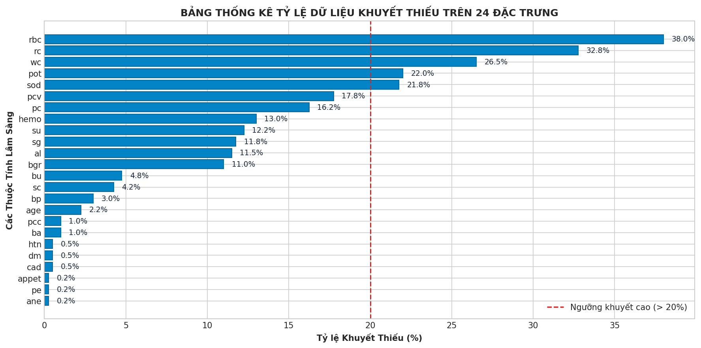
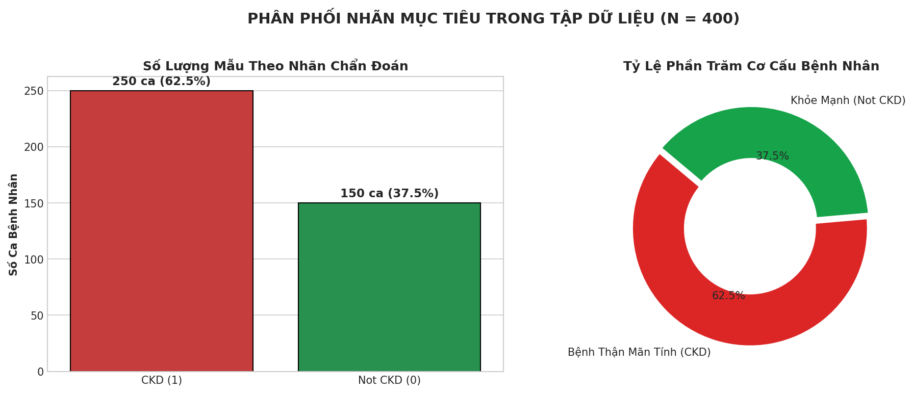
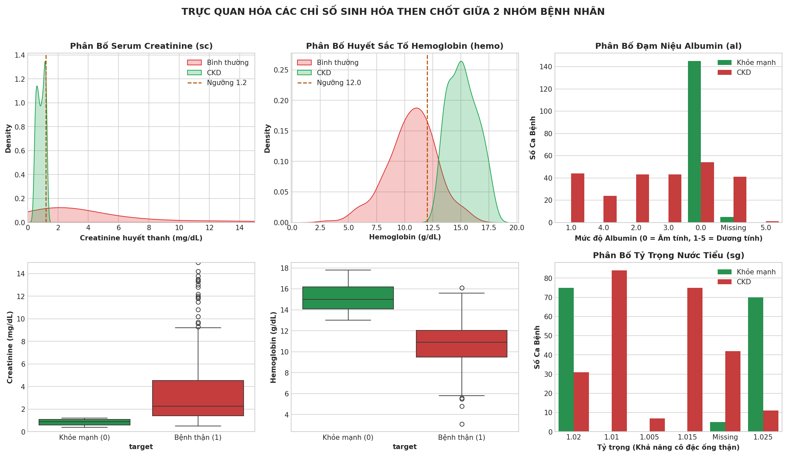
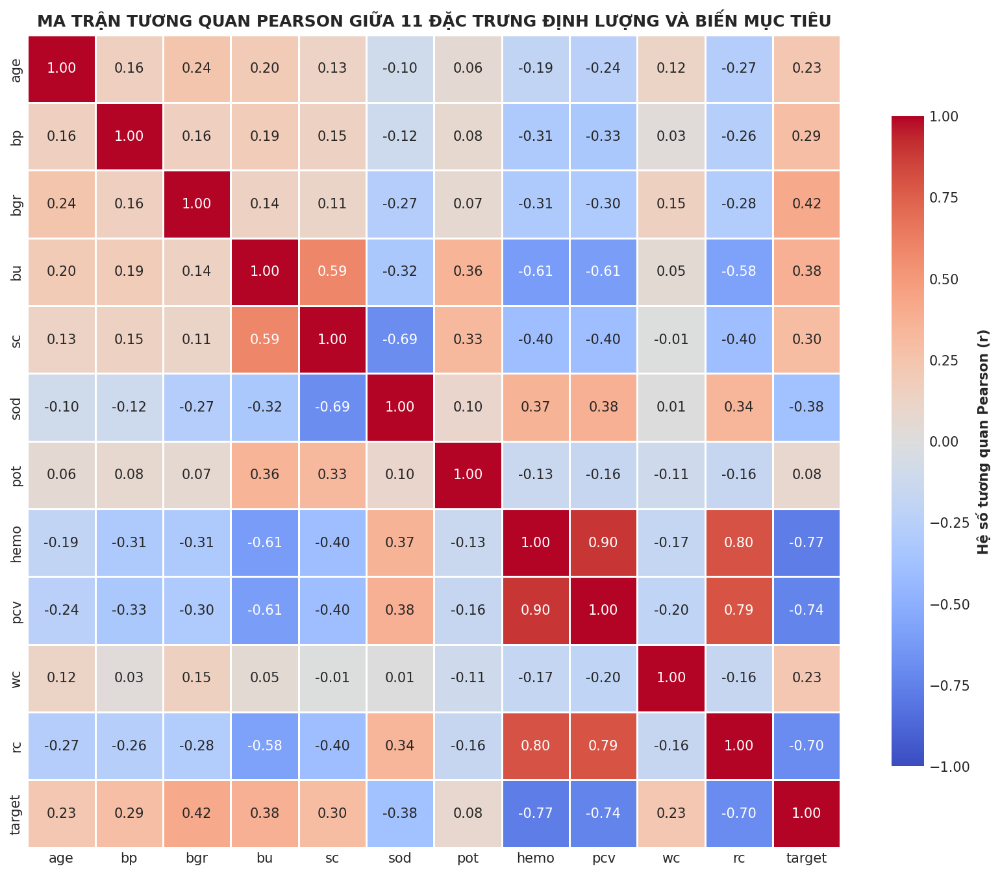
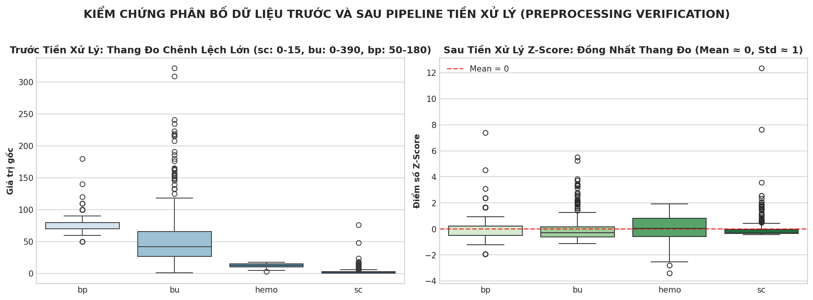

# CHƯƠNG 3. THIẾT LẬP THỰC NGHIỆM: BỘ DỮ LIỆU VÀ TIỀN XỬ LÝ

## 3.1. MÔ TẢ BỘ DỮ LIỆU CHRONIC KIDNEY DISEASE (CKD)

### 3.1.1. Nguồn gốc dữ liệu
Bộ dữ liệu sử dụng trong nghiên cứu là **Chronic Kidney Disease Dataset**, thu thập trong khoảng thời gian 2 tháng tại Bệnh viện Apollo (Tamilnadu, Ấn Độ) và được công bố công khai trên **UCI Machine Learning Repository** cũng như nền tảng **Kaggle** (`akshayksingh/kidney-disease-dataset` — đúng theo đặc tả Đề tài số 04 của Bộ môn KHDL – HUIT).

Trong mã nguồn dự án (`src/data_loader.py` và Notebook Cell 05), hệ thống thiết lập cơ chế nạp dữ liệu tự động theo thứ tự ưu tiên:
1. Nạp trực tiếp từ Google Drive (`/content/drive/MyDrive/DatasetForProject/MLDataset/kidney_disease.csv`) khi chạy trên Google Colab.
2. Nạp từ thư mục cục bộ dự án (`DatasetForProject/MLDataset/kidney_disease.csv` hoặc `data/kidney_disease.csv`).
3. Tự động tải phiên bản mới nhất từ `kagglehub` nếu chưa có tệp cục bộ.

### 3.1.2. Tổng quan cấu trúc và phân loại 24 thuộc tính
Tập dữ liệu gốc gồm **$N = 400$ dòng** (tương ứng 400 bệnh nhân) và **26 cột**, bao gồm 1 cột mã định danh (`id`), **24 đặc trưng đầu vào** (11 biến định lượng và 13 biến định tính) và 1 cột nhãn mục tiêu (`classification`).

#### Bảng 3.1: Danh mục 11 thuộc tính định lượng (Numerical Features)

| STT | Ký hiệu | Tên đầy đủ | Đơn vị | Ý nghĩa lâm sàng |
| :---: | :---: | :--- | :---: | :--- |
| 1 | `age` | Age | Năm | Độ tuổi của bệnh nhân |
| 2 | `bp` | Blood Pressure | mmHg | Huyết áp tâm trương |
| 3 | `bgr` | Blood Glucose Random | mg/dL | Đường huyết ngẫu nhiên |
| 4 | `bu` | Blood Urea | mg/dL | Nồng độ Urê trong máu |
| 5 | `sc` | Serum Creatinine | mg/dL | Creatinine huyết thanh (chỉ số lọc cầu thận) |
| 6 | `sod` | Sodium | mEq/L | Nồng độ điện giải Natri máu |
| 7 | `pot` | Potassium | mEq/L | Nồng độ điện giải Kali máu |
| 8 | `hemo` | Hemoglobin | g/dL | Huyết sắc tố hồng cầu |
| 9 | `pcv` | Packed Cell Volume | % | Dung tích khối hồng cầu |
| 10 | `wc` | White Blood Cell Count | cells/cumm | Số lượng tế bào bạch cầu |
| 11 | `rc` | Red Blood Cell Count | millions/cmm | Số lượng tế bào hồng cầu |

#### Bảng 3.2: Danh mục 13 thuộc tính định tính (Categorical Features)

| STT | Ký hiệu | Tên đầy đủ | Miền giá trị | Ý nghĩa lâm sàng |
| :---: | :---: | :--- | :---: | :--- |
| 1 | `sg` | Specific Gravity | 1.005 – 1.025 | Tỷ trọng nước tiểu (khả năng cô đặc ống thận) |
| 2 | `al` | Albumin | 0, 1, 2, 3, 4, 5 | Mức độ đạm niệu Albumin |
| 3 | `su` | Sugar | 0, 1, 2, 3, 4, 5 | Mức độ đường trong nước tiểu |
| 4 | `rbc` | Red Blood Cells | `normal`, `abnormal` | Hồng cầu niệu |
| 5 | `pc` | Pus Cell | `normal`, `abnormal` | Tế bào mủ trong nước tiểu |
| 6 | `pcc` | Pus Cell Clumps | `present`, `notpresent` | Đám tế bào mủ |
| 7 | `ba` | Bacteria | `present`, `notpresent` | Vi khuẩn niệu |
| 8 | `htn` | Hypertension | `yes`, `no` | Tiền sử tăng huyết áp |
| 9 | `dm` | Diabetes Mellitus | `yes`, `no` | Tiền sử đái tháo đường |
| 10 | `cad` | Coronary Artery Disease | `yes`, `no` | Bệnh động mạch vành |
| 11 | `appet` | Appetite | `good`, `poor` | Cảm giác ăn ngon miệng |
| 12 | `pe` | Pedal Edema | `yes`, `no` | Phù mắt cá chân / phù ngoại biên |
| 13 | `ane` | Anemia | `yes`, `no` | Hội chứng thiếu máu lâm sàng |

### 3.1.3. Phân tích biến mục tiêu (`classification`)
Cột `classification` chứa 2 lớp phân loại sau làm sạch:
- **Mắc bệnh thận mãn tính (`ckd` $\to$ Nhãn `1`):** 250 bệnh nhân (chiếm **62.50%**).
- **Không mắc bệnh (`notckd` $\to$ Nhãn `0`):** 150 bệnh nhân (chiếm **37.50%**).
Tỷ lệ mất cân bằng là $1.67 : 1$ (mất cân bằng nhẹ), đủ điều kiện sử dụng phương pháp phân chia phân tầng (*Stratified Split*) mà không cần sinh mẫu giả SMOTE.

### 3.1.4. Kiểm toán dữ liệu đầu vào tường minh (Data Audit)
Trước khi đưa vào phân tích và huấn luyện, nhóm thực hiện kiểm toán dữ liệu đầu vào tường minh (`CKDDataLoader.audit_raw_data()` và Notebook Cell 05) và ghi nhận 5 kết quả then chốt:
1. **Dòng trùng lặp (`df_raw.duplicated().sum()`):** **`0` dòng trùng lặp** (cả trước và sau khi làm sạch chuỗi).
2. **Cột hằng số (`df_raw.nunique() <= 1`):** **`0` cột hằng số** — mọi thuộc tính lâm sàng đều mang biến thiên thông tin hợp lệ (`nunique` từ `2` đến `146`).
3. **Cột định danh (`nunique == len(df_raw)`):** Phát hiện duy nhất **1 cột là `id`** (`400/400` giá trị duy nhất từ `0` đến `399`). Vì `id` chỉ là số thứ tự hồ sơ và không mang ý nghĩa sinh học, cột này bắt buộc bị loại bỏ để tránh mô hình học vẹt.
4. **Ký tự rác ẩn và sai kiểu dữ liệu:** Xuất hiện ký tự tab thừa và dấu hỏi (`"\t?"`, `"\tno"`, `"\tyes"`, `" yes"`, `"ckd\t"`) khiến cột `dm` có tới `5` giá trị rời rạc thô, `cad` và `classification` có `3` giá trị thô, đồng thời 3 cột định lượng `pcv`, `wc`, `rc` bị pandas đọc nhầm thành kiểu chuỗi (`object`).
5. **Giá trị khuyết thiếu lớn:** Sau khi ép kiểu chuẩn về số và chuyển các chuỗi `"?"` sang `NaN`, cả **24/24 cột đặc trưng** đều có giá trị khuyết với tổng cộng **`1,012 / 9,600` ô `NaN` (`10.54%`)**, cao nhất là `rbc` (`38.00%`) và `rc` (`32.75%`).

---

## 3.2. TRỰC QUAN HÓA DỮ LIỆU (DATA VISUALIZATION — EDA)

### 3.2.1. Thống kê dữ liệu khuyết thiếu trên 24 thuộc tính

*Nhận xét (Hình 3.1):* Có 5 thuộc tính vượt ngưỡng khuyết cao ($>20\%$) gồm `rbc` ($38.00\%$ — 152 ca), `rc` ($32.75\%$ — 131 ca), `wc` ($26.50\%$ — 106 ca), `pot` ($22.00\%$ — 88 ca) và `sod` ($21.75\%$ — 87 ca). Đây là đặc thù **MAR (Missing At Random)** trong hồ sơ y tế thực tế vì bác sĩ không chỉ định xét nghiệm chuyên sâu đối với người khám sức khỏe bình thường. Nếu xóa bỏ dòng thiếu (`dropna`), tập dữ liệu sẽ mất hơn 60% số ca bệnh; do đó bắt buộc phải áp dụng kỹ thuật điền khuyết (*Imputation*).

### 3.2.2. Phân phối biến mục tiêu CKD vs Not-CKD

*Nhận xét (Hình 3.2):* Nhóm mắc CKD chiếm $62.50\%$ (250 ca) và nhóm khỏe mạnh chiếm $37.50\%$ (150 ca). Phân phối chênh lệch nhẹ nên trong quá trình đánh giá mô hình cần theo dõi đồng thời Recall, Precision, F1-Score và ROC-AUC thay vì chỉ nhìn vào Accuracy.

### 3.2.3. Phân tích "Tam giác vàng sinh hóa" (`sc`, `hemo`, `al`, `sg`) kèm bảng số liệu dẫn chứng

#### Bảng 3.3: Thống kê mô tả các chỉ số định lượng vàng theo nhóm bệnh (`df.groupby('target').agg`)

| Chỉ số | Nhóm Not CKD (0) — Mean / Median | Nhóm Not CKD (0) — Min – Max | Nhóm CKD (1) — Mean / Median | Nhóm CKD (1) — Min – Max |
| :--- | :---: | :---: | :---: | :---: |
| **`sc`** (mg/dL) | `0.87` / `0.90` | `0.40 – 1.20` | **`4.41` / `2.25`** | `0.50 – 76.00` |
| **`hemo`** (g/dL) | `15.19` / `15.00` | `13.00 – 17.80` | **`10.65` / `10.90`** | `3.10 – 16.10` |
| **`bu`** (mg/dL) | `32.80` / `33.00` | `10.00 – 50.00` | **`72.39` / `53.00`** | `1.50 – 391.00` |
| **`bgr`** (mg/dL) | `107.72` / `107.50` | `70.00 – 140.00` | **`175.42` / `143.50`** | `22.00 – 490.00` |
| **`age`** (năm) | `46.52` / `46.00` | `12.00 – 80.00` | **`54.54` / `59.00`** | `2.00 – 90.00` |

#### Bảng 3.4: Tỷ lệ `%` mắc CKD theo các biến phân loại quan trọng (`pd.crosstab(..., normalize='index') * 100`)

| Biến phân loại | Giá trị | Số ca Not CKD ($n$) | Số ca CKD ($n$) | Tỷ lệ mắc CKD (%) |
| :--- | :---: | :---: | :---: | :---: |
| **`al`** (Albumin niệu) | `0.0` / `1.0 – 5.0` | `145` / `0` | `54` / `155` | `27.14%` / **`100.00%`** |
| **`sg`** (Tỷ trọng niệu) | `1.005 – 1.015` / `1.020` / `1.025` | `0` / `75` / `70` | `166` / `31` / `11` | **`100.00%`** / `29.25%` / `13.58%` |
| **`htn`** (Tăng huyết áp) | `no` / `yes` | `148` / `0` | `103` / `147` | `41.04%` / **`100.00%`** |
| **`dm`** (Đái tháo đường) | `no` / `yes` | `148` / `0` | `113` / `137` | `43.30%` / **`100.00%`** |
| **`pe`** (Phù ngoại biên) | `no` / `yes` | `149` / `0` | `174` / `76` | `53.87%` / **`100.00%`** |
| **`ane`** (Thiếu máu) | `no` / `yes` | `149` / `0` | `190` / `60` | `56.05%` / **`100.00%`** |

*Nhận xét dẫn chứng (Hình 3.3 & Bảng 3.3–3.4):*
- **Serum Creatinine (`sc`):** Nhóm khỏe mạnh tập trung chặt trong dải `0.40 – 1.20 mg/dL` (trung vị `0.90`); nhóm CKD lệch phải rất mạnh với trung bình `4.41 mg/dL` (trung vị `2.25`, tối đa `76.00 mg/dL`).
- **Hemoglobin (`hemo`):** Nhóm khỏe mạnh đạt trung bình `15.19 g/dL` (`13.00 – 17.80`); nhóm CKD tụt sâu còn `10.65 g/dL` (trung vị `10.90`).
- **Biến phân loại:** 100.00% bệnh nhân có `al >= 1.0`, `sg <= 1.015`, `htn = 'yes'`, `dm = 'yes'`, `pe = 'yes'` hoặc `ane = 'yes'` đều thuộc nhóm mắc CKD.

### 3.2.4. Ma trận tương quan tuyến tính Pearson (Correlation Heatmap) & Tổng kết `eda_summary`

*Nhận xét (Hình 3.4):*
- Các biến có tương quan nghịch rất mạnh với nguy cơ CKD gồm: **Hemoglobin `hemo`** ($r = -0.769 \approx -0.77$), **Dung tích hồng cầu `pcv`** ($r = -0.741 \approx -0.74$), **Số lượng hồng cầu `rc`** ($r = -0.699 \approx -0.70$) và **Natri máu `sod`** ($r = -0.376 \approx -0.38$).
- Các biến tương quan thuận rõ rệt gồm: **Đường huyết `bgr`** ($r = +0.420 \approx +0.42$), **Urê máu `bu`** ($r = +0.381 \approx +0.38$), **Creatinine `sc`** ($r = +0.300$) và **Huyết áp `bp`** ($r = +0.294$).
- **Đa cộng tuyến nội tại:** Cặp `hemo` – `pcv` có hệ số tương quan đạt $r = +0.895$ và cặp `bu` – `sc` đạt $r = +0.586$. Điều này giải thích lợi thế vượt trội của mô hình rừng cây Random Forest so với Naïve Bayes hay hồi quy tuyến tính thuần túy.

#### Bảng 3.5: Bảng tổng hợp cô đọng cuối phần EDA (`eda_summary`)

| Chỉ tiêu kiểm toán (EDA Summary) | Kết quả ghi nhận |
| :--- | :--- |
| Tổng số dòng (bệnh nhân) | `400` |
| Tổng số cột đặc trưng đầu vào | `24` (`11` định lượng + `13` định tính) |
| Tổng số ô khuyết thiếu (`NaN`) | `1,012 / 9,600` (`10.54%`) trên `24/24` cột |
| Số dòng trùng lặp (`duplicated`) | `0` |
| Số cột hằng số (`nunique <= 1`) | `0` |
| Số lượng nhãn `CKD (target = 1)` | `250` (`62.50%`) |
| Số lượng nhãn `Not CKD (target = 0)` | `150` (`37.50%`) |

---

## 3.3. QUY TRÌNH TIỀN XỬ LÝ DỮ LIỆU CHUẨN Y KHOA CHỐNG RÒ RỈ DỮ LIỆU

### 3.3.1. Làm sạch chuỗi rác và loại bỏ cột định danh `id`
- Loại bỏ cột `id` (`nunique = 400`) để tránh mô hình học vẹt số thứ tự bệnh nhân.
- Thực hiện chuẩn hóa chuỗi (`str.strip()`), thay thế toàn bộ ký tự `"\t?"`, `"?"`, `""` thành `np.nan`, chuẩn hóa nhãn mục tiêu `ckd -> 1` và `notckd -> 0`, đồng thời ép kiểu số thực (`float64`) cho 11 biến định lượng.

### 3.3.2. Chia tập dữ liệu phân tầng (Stratified Train/Test Split)
Thực hiện tách tập dữ liệu **TRƯỚC** khi điền khuyết và chuẩn hóa để triệt tiêu hoàn toàn nguy cơ rò rỉ dữ liệu (*Data Leakage*):
- **Tập huấn luyện (Train set — 80%):** 320 bệnh nhân (200 CKD, 120 Not-CKD).
- **Tập kiểm thử độc lập (Test set — 20%):** 80 bệnh nhân (50 CKD, 30 Not-CKD).
- Sử dụng tham số `stratify=y` và `random_state=42` để bảo đảm tính tái lập thực nghiệm.

### 3.3.3. Xử lý giá trị khuyết thiếu (Imputation), Mã hóa One-Hot và Chuẩn hóa Z-Score
Đóng gói hai nhánh xử lý độc lập trong `ColumnTransformer`, chỉ gọi `.fit()` duy nhất trên `X_train`:
- **Nhánh 11 biến định lượng:** `SimpleImputer(strategy='median')` $\to$ `StandardScaler()` ($z = \frac{x - \mu_{\text{train}}}{\sigma_{\text{train}}}$). Chọn Trung vị vì các chỉ số sinh hóa như `sc`, `bu`, `bgr` có đuôi lệch phải rất dài (`sc` lên tới `76.0 mg/dL`).
- **Nhánh 13 biến định tính:** `SimpleImputer(strategy='most_frequent')` $\to$ `OneHotEncoder(drop='first', handle_unknown='ignore', sparse_output=False)` để tránh bẫy đa cộng tuyến (*Dummy Variable Trap*) và xử lý an toàn khi dữ liệu thực tế xuất hiện danh mục mới.

#### Bảng 3.6: Đối chiếu chi tiết số lượng & danh sách cột Trước vs Sau Tiền xử lý (`get_feature_names_out()`)

| Nhóm đặc trưng | Trước tiền xử lý | Sau tiền xử lý | Phép biến đổi & Danh sách cột đầu ra |
| :--- | :---: | :---: | :--- |
| **Biến định lượng (`num__*`)** | `11` | `11` | `num__age`, `num__bp`, `num__bgr`, `num__bu`, `num__sc`, `num__sod`, `num__pot`, `num__hemo`, `num__pcv`, `num__wc`, `num__rc` |
| **Biến định tính (`cat__*`)** | `13` | `24` | `cat__sg_1.01`, `cat__sg_1.015`, `cat__sg_1.02`, `cat__sg_1.025`, `cat__al_1.0`..`5.0`, `cat__su_1.0`..`5.0`, `cat__rbc_normal`, `cat__pc_normal`, `cat__pcc_present`, `cat__ba_present`, `cat__htn_yes`, `cat__dm_yes`, `cat__cad_yes`, `cat__appet_poor`, `cat__pe_yes`, `cat__ane_yes` |
| **TỔNG CỘNG** | **`24`** | **`35`** | **Hoàn toàn sạch: `0` ô `NaN` trên cả Train (`320×35`) và Test (`80×35`)** |

### 3.3.4. Kiểm chứng phân bố dữ liệu trước và sau tiền xử lý

*Nhận xét (Hình 3.5):* Trước khi tiền xử lý, thang đo giữa Urê máu (`bu` lên tới `391 mg/dL`), Huyết áp (`bp` `50–180 mmHg`) và Creatinine (`sc` `0.4–15+ mg/dL`) chênh lệch hàng chục lần. Sau khi đi qua Pipeline `StandardScaler`, cả 4 chỉ số (`bp`, `bu`, `hemo`, `sc`) đều được quy chiếu đồng nhất quanh trục $z = 0$ ($\mu \approx 0, \sigma \approx 1$) trong khi vẫn giữ nguyên đặc trưng hình học của các ca bệnh nặng.
