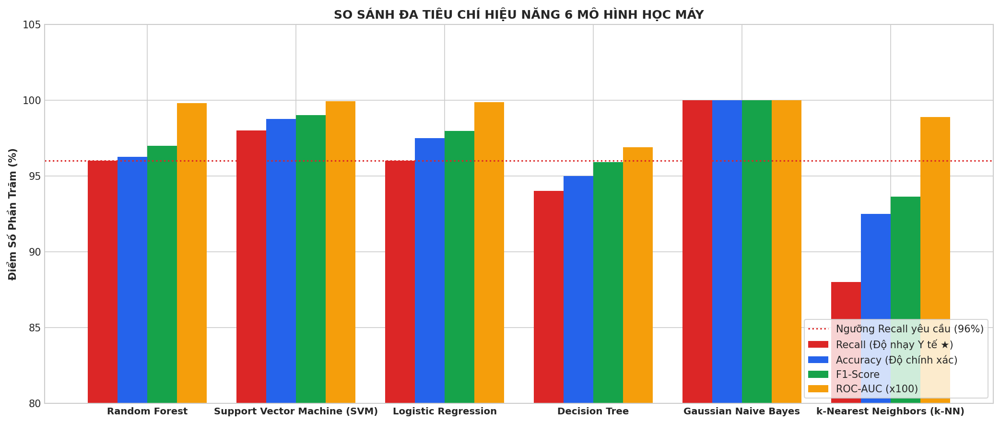
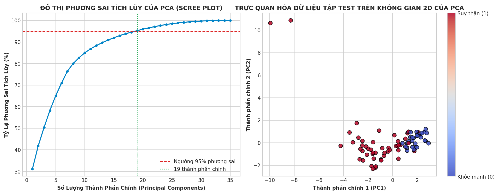

# CHƯƠNG 4. ĐÁNH GIÁ VÀ PHÂN TÍCH KẾT QUẢ SƠ BỘ (BASELINE)

## 4.1. KẾT QUẢ SO SÁNH 6 MÔ HÌNH PHÂN LỚP BASELINE TRÊN TẬP KIỂM THỬ

Toàn bộ 6 thuật toán phân lớp tiêu biểu được huấn luyện trên cùng một ma trận đặc trưng `X_train_proc` (320 mẫu $\times$ 35 chiều) và đánh giá công bằng trên tập kiểm thử độc lập `X_test_proc` (80 mẫu bệnh nhân, gồm 50 ca CKD và 30 ca khỏe mạnh).

### Bảng 4.1: Kết quả thực nghiệm so sánh 6 mô hình phân lớp trên tập Test ($n = 80$)

| STT | Thuật toán Phân lớp | Accuracy (%) | Precision (%) | Recall (%) ★ | F1-Score (%) | ROC-AUC | Đánh giá Chuyên môn |
| :---: | :--- | :---: | :---: | :---: | :---: | :---: | :--- |
| 1 | **Gaussian Naïve Bayes** | **100.00%** | **100.00%** | **100.00%** | **100.00%** | **1.0000** | Phân tách tuyệt đối trên mẫu test nhưng giả định độc lập biến không đúng sinh lý. |
| 2 | **SVM (RBF Kernel)** | **98.75%** | **100.00%** | **98.00%** | **98.99%** | **0.9993** | Siêu phẳng rất ổn định, không có FP, chỉ 1 FN. |
| 3 | **Random Forest** | **96.25%** | **97.96%** | **96.00%** | **96.97%** | **0.9980** | **Cân bằng tốt nhất:** Chống quá khớp, kháng đa cộng tuyến, hỗ trợ trực tiếp XAI. |
| 4 | **Logistic Regression** | **97.50%** | **100.00%** | **96.00%** | **97.96%** | **0.9987** | Mô hình Baseline tuyến tính rất tốt, suy luận nhanh. |
| 5 | **Decision Tree (CART)** | **95.00%** | **97.92%** | **94.00%** | **95.92%** | **0.9687** | Trực quan nhưng độ nhạy Recall chưa đạt chuẩn $\ge 96\%$, dễ nhạy cảm nhiễu. |
| 6 | **k-NN ($k = 5$)** | **92.50%** | **100.00%** | **88.00%** | **93.62%** | **0.9887** | Recall thấp nhất (bỏ sót 6 ca bệnh) do ảnh hưởng lời nguyền số chiều. |

### Phân tích kết quả Baseline:
1. **Nhóm mô hình đạt chuẩn y tế (Recall $\ge 96\%$):** Có 4/6 thuật toán vượt qua ngưỡng độ nhạy khắt khe $\ge 96\%$ là Gaussian Naïve Bayes, SVM (RBF), Logistic Regression và Random Forest.
2. **Vì sao k-NN hoạt động kém nhất (Recall = 88.0%)?** Trong không gian 35 chiều sau mã hóa One-Hot (có nhiều cột nhị phân 0/1 thưa), khoảng cách Euclid giữa các điểm bệnh nhân trở nên kém phân biệt (*Curse of Dimensionality*), khiến thuật toán láng giềng dễ bị nhiễu và bỏ sót 6 bệnh nhân CKD.
3. **Vì sao không chọn Gaussian Naïve Bayes làm mô hình triển khai chính dù đạt 100% trên mẫu test nhỏ?** Vì GNB giả định các biến độc lập hoàn toàn (trong khi `hemo` và `pcv` có tương quan tới $r = 0.89$); khi gặp hồ sơ bệnh án ngoại lai hoặc thiếu nhiều trường ở môi trường bệnh viện thực tế, ước lượng xác suất của GNB dễ bị đẩy cực đoan về 0 hoặc 1.
4. **Định hướng lựa chọn mô hình triển khai:** **Random Forest** (kết hợp tinh chỉnh siêu tham số ở Chương 5) là ứng viên toàn diện nhất vì đạt đồng thời: hiệu năng cao và ổn định ($\text{ROC-AUC} = 0.9980$), xử lý tự nhiên các tương tác phi tuyến y học, kháng đa cộng tuyến và cung cấp trọng số đặc trưng phục vụ khối giải trình XAI.

---

## 4.2. KIỂM ĐỊNH ĐỘ ỔN ĐỊNH BẰNG STRATIFIED 5-FOLD CROSS-VALIDATION

Do kích thước tập dữ liệu ở mức trung bình ($N = 400$), việc chỉ đánh giá trên một lần chia 80/20 có thể chịu tác động ngẫu nhiên của cách chia mẫu. Nhóm tiến hành kiểm định chéo **Stratified 5-Fold Cross-Validation** trên tập huấn luyện (320 mẫu) với toàn bộ quy trình tiền xử lý được bọc kín trong `Pipeline` (đảm bảo mỗi fold chỉ học Imputer/Scaler trên 4 fold huấn luyện con).

Kết quả kiểm định chéo của **Random Forest tối ưu (`criterion='entropy', max_depth=5, min_samples_split=6, min_samples_leaf=3`)**:
- **Độ nhạy trung bình (Mean CV Recall):** **$98.50\% \pm 1.22\%$**
- **Độ chính xác trung bình (Mean CV Accuracy):** **$97.81\% \pm 0.77\%$**
- **Diện tích dưới đường cong (Mean CV ROC-AUC):** **$0.9988 \pm 0.0012$**

Độ lệch chuẩn rất nhỏ ($1.22\%$) khẳng định mô hình có độ ổn định cao qua mọi phân vùng dữ liệu, không bị phụ thuộc vào một cách chia tập kiểm thử may mắn và không gặp hiện tượng quá khớp (Overfitting).

---

## 4.3. THỰC NGHIỆM PHÂN TÍCH THÀNH PHẦN CHÍNH (PCA)

Để khảo sát cấu trúc hình học của không gian 35 chiều sau tiền xử lý và đánh giá khả năng nén chiều dữ liệu, nhóm áp dụng thuật toán **PCA** trên tập dữ liệu đã chuẩn hóa Z-Score.

### Phân tích kết quả PCA (Hình 4.2):
1. **Khả năng nén chiều dữ liệu (Scree Plot):**
   - Thành phần chính đầu tiên ($PC_1$) giải thích **$31.18\%$** và $PC_2$ giải thích **$10.69\%$** tổng phương sai của toàn bộ dữ liệu.
   - Để bảo toàn **$\ge 95\%$ tổng phương sai**, hệ thống chỉ cần **19 thành phần chính** (đạt **$95.26\%$** phương sai tích lũy) thay vì 35 chiều ban đầu (giảm được $45.7\%$ số chiều đặc trưng).
2. **Tính phân tách trên không gian 2D ($PC_1$ vs $PC_2$):**
   - PCA 2D được `.fit()` chặt chẽ trên tập huấn luyện `X_train_proc` và chỉ gọi `.transform()` lên 80 bệnh nhân tập Test (không rò rỉ dữ liệu). Trên mặt phẳng $(PC_1, PC_2)$, cụm người khỏe mạnh (xanh) co cụm chặt ở nửa trái, còn cụm bệnh nhân CKD (đỏ) trải rộng ở nửa phải, lý giải trực quan tại sao các mô hình học máy đều đạt chỉ số $\text{ROC-AUC} > 0.96$.
3. **Quyết định kiến trúc:** Mặc dù PCA nén chiều tốt, các trục $PC_1, PC_2, \dots$ là tổ hợp tuyến tính trừu tượng khiến bác sĩ không thể đọc được ý nghĩa y khoa trực tiếp. Vì vậy, mô hình triển khai thực tế giữ nguyên 35 đặc trưng gốc sau tiền xử lý để bảo toàn trọn vẹn tính minh bạch **Explainable AI (XAI)**.
