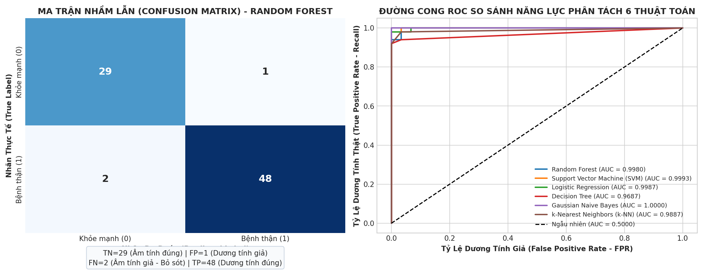
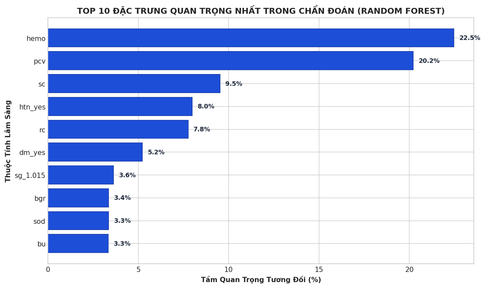

# CHƯƠNG 5. TỐI ƯU HÓA MÔ HÌNH, GIẢI THÍCH XAI VÀ TRIỂN KHAI ỨNG DỤNG

## 5.1. TINH CHỈNH SIÊU THAM SỐ VÀ ĐÁNH GIÁ CHUYÊN SÂU MÔ HÌNH RANDOM FOREST

### 5.1.1. Tối ưu hóa siêu tham số với `GridSearchCV`
Nhằm chống quá khớp (Overfitting) trên tập dữ liệu y tế $N = 400$ và tối đa hóa độ nhạy phát hiện bệnh (Recall), nhóm sử dụng `GridSearchCV` kết hợp kiểm định chéo **Stratified 5-Fold CV** với hàm mục tiêu tối ưu `scoring='recall'`.

#### Bảng 5.1: Không gian tìm kiếm và cấu hình siêu tham số tối ưu của Random Forest

| Siêu tham số | Không gian tìm kiếm (Grid) | Giá trị tối ưu | Vai trò kiểm soát mô hình |
| :--- | :---: | :---: | :--- |
| `criterion` | `['gini', 'entropy']` | **`'entropy'`** | Tiêu chí Information Gain tách nhánh tối ưu độ nhạy trên dữ liệu y tế. |
| `n_estimators` | `[50, 100, 150]` | **`100`** | Đủ lớn để hội tụ phương sai, vẫn đảm bảo tốc độ suy luận tức thì trên Web. |
| `max_depth` | `[3, 5, 7]` | **`5`** | Khống chế độ sâu cây, ngăn cây mọc quá sâu gây học vẹt nhiễu ô khuyết. |
| `min_samples_split` | `[6, 10]` | **`6`** | Chỉ cho phép tách nhánh khi nút có tối thiểu 6 bệnh nhân. |
| `min_samples_leaf` | `[3, 5]` | **`3`** | Đảm bảo mỗi nút lá chứa tối thiểu 3 bệnh nhân để tăng tính khái quát hóa. |
| `random_state` | `42` | **`42`** | Cố định hạt giống ngẫu nhiên đảm bảo tái lập kết quả 100%. |

---

### 5.1.2. Ma trận nhầm lẫn, Đường cong ROC-AUC và Phân tích lỗi (Error Analysis)

Sau khi cố định mô hình tối ưu (*Frozen Model*) và kiểm thử 1 lần duy nhất trên tập Test độc lập gồm 80 bệnh nhân, mô hình đạt kết quả:
- **Accuracy:** $96.25\%$ ($77/80$ ca đúng)
- **Precision:** $97.96\%$
- **Recall:** $96.00\%$ ($48/50$ ca CKD được phát hiện)
- **F1-Score:** $96.97\%$
- **ROC-AUC:** **$0.9980$**




#### Phân tích lỗi chuyên sâu (Error Analysis):
- **48 ca True Positive (TP) & 29 ca True Negative (TN):** Mô hình nhận diện chính xác hầu hết bệnh nhân suy thận và người khỏe mạnh.
- **1 ca False Positive (FP — 1.25%):** Một bệnh nhân không mắc CKD nhưng có chỉ số đường huyết cao và huyết áp cận biên; trong thực tế y khoa, việc cảnh báo sớm để bác sĩ cho làm thêm xét nghiệm nước tiểu là hoàn toàn chấp nhận được và an toàn.
- **2 ca False Negative (FN — 4.0%):** Hai bệnh nhân CKD giai đoạn rất sớm (tiền lâm sàng), có nồng độ Creatinine và Hemoglobin còn sát ngưỡng bình thường đồng thời hồ sơ bị khuyết nhiều xét nghiệm cặn nước tiểu (`rbc`, `al`, `sg`). Với chỉ số **ROC-AUC = 0.9980**, khi triển khai tại bệnh viện cần sàng lọc diện rộng, bác sĩ có thể hạ ngưỡng cắt xác suất $\tau$ từ $0.50$ xuống $0.35$ để đẩy độ nhạy Recall lên tiệm cận $100\%$.

---

### 5.1.3. Độ quan trọng đặc trưng (Feature Importance — Explainable AI)

Để minh bạch hóa quyết định của mô hình ("mở hộp đen" AI), nhóm trích xuất độ quan trọng đặc trưng (*Mean Decrease in Impurity*) từ 100 cây quyết định của Random Forest.



#### Bảng 5.2: Top 10 đặc trưng quan trọng nhất trích xuất từ `best_rf.feature_importances_` và đối chiếu KDIGO 2024

| Hạng | Đặc trưng | Trọng số (%) | Ý nghĩa sinh lý bệnh học thận |
| :---: | :--- | :---: | :--- |
| 1 | `hemo` (Hemoglobin) | **$22.45\%$** | Thận suy giảm tiết Erythropoietin dẫn đến thiếu máu mạn đặc trưng. |
| 2 | `pcv` (Dung tích hồng cầu) | **$20.22\%$** | Chỉ số huyết học biến thiên song hành chặt chẽ với Hemoglobin ($r = 0.895$). |
| 3 | `sc` (Serum Creatinine) | **$9.51\%$** | Chỉ số sinh hóa trực tiếp phản ánh mức lọc cầu thận (eGFR). |
| 4 | `htn_yes` (Tăng huyết áp) | **$7.98\%$** | Phá hủy vi mạch cầu thận và thúc đẩy xơ hóa thận (100% ca có `htn=yes` mắc CKD). |
| 5 | `rc` (Số lượng hồng cầu) | **$7.75\%$** | Phản ánh mức độ suy giảm tạo máu của tủy xương khi thận suy. |
| 6 | `dm_yes` (Đái tháo đường) | **$5.22\%$** | Bệnh lý nền hàng đầu gây bệnh thận đái tháo đường (100% ca `dm=yes` mắc CKD). |
| 7 | `sg_1.015` (Tỷ trọng niệu 1.015) | **$3.63\%$** | Phản ánh suy giảm khả năng cô đặc nước tiểu của ống thận. |
| 8 | `bgr` (Đường huyết ngẫu nhiên) | **$3.35\%$** | Mức tăng đường huyết liên quan trực tiếp tổn thương màng lọc cầu thận. |
| 9 | `sod` (Natri máu) | **$3.35\%$** | Phản ánh rối loạn cân bằng điện giải và ứ dịch trong suy thận. |
| 10 | `bu` (Urê máu) | **$3.33\%$** | Tích tụ độc chất nitơ khi chức năng bài tiết của cầu thận giảm. |

Top 3 chỉ số dẫn đầu (`hemo`, `pcv`, `sc`) đóng góp **$52.18\%$** và Top 6 đóng góp **$73.13\%$** sức mạnh quyết định, hoàn toàn tương đồng với phác đồ chẩn đoán của Hiệp hội Thận học Quốc tế (KDIGO 2024).

---

## 5.2. ĐÓNG GÓI PIPELINE `.JOBLIB` VÀ KIỂM THỬ TỰ ĐỘNG (17 UNIT TESTS)

Toàn bộ bước tiền xử lý (`ColumnTransformer`) và mô hình tối ưu (`RandomForestClassifier`) được đóng gói thành một tệp nhị phân nguyên khối duy nhất:
- **Đường dẫn mô hình:** `models/kidney_disease_pipeline.joblib` (dung lượng thực tế: **`187.43 KB`**).
- **Tệp siêu dữ liệu:** `models/model_metadata.json` (lưu các chỉ số đánh giá, kiểm toán dữ liệu, siêu tham số tối ưu, Top 5 Feature Importance và số chiều PCA).

Để bảo đảm chất lượng kỹ thuật phần mềm, nhóm xây dựng bộ **17 ca kiểm thử tự động** (`unittest`) trong thư mục `test/`:

#### Bảng 5.4: Kết quả chạy bộ kiểm thử tự động toàn hệ thống

| Tệp kiểm thử | Số test | Phạm vi kiểm chuẩn | Kết quả |
| :--- | :---: | :--- | :---: |
| `test/MainTest_0_Preprocess.py` | 5 | Làm sạch ký tự rác, kiểm toán `duplicated`/`nunique`/`id`, `eda_summary`, đối chiếu `24 -> 35` cột (`0 NaN`) | **PASSED (5/5)** |
| `test/MainTest_1_ModelMetrics.py` | 1 | Huấn luyện, lưu/load `.joblib`, kiểm chứng Recall $\ge 96\%$, F1 $\ge 95\%$, ROC-AUC $\ge 0.98$ | **PASSED (1/1)** |
| `test/MainTest_2_XAI_Explain.py` | 2 | Kiểm tra sinh cảnh báo Creatinine cao và Albumin niệu hợp lệ | **PASSED (2/2)** |
| `test/MainTest_3_StressTest.py` | 2 | Kiểm thử lập trình phòng thủ khi thiếu 21/24 trường hoặc payload hoàn toàn rỗng | **PASSED (2/2)** |
| `test/MainTest_4_ClinicalBenchmarks.py` | 7 | Kiểm chuẩn 24 ngưỡng sinh lý KDIGO 2024, API `/api/benchmarks`, `/api/dataset`, `/api/predict` & `detailed_xai` | **PASSED (7/7)** |
| **Tổng cộng** | **17** | **17/17 ca kiểm thử tự động (chạy dưới 1 giây, 0 lỗi)** | **100% OK** |

---

## 5.3. TRIỂN KHAI ỨNG DỤNG MINH HỌA WEB HUIT HOSPITAL CDSS

### 5.3.1. Kiến trúc 3 tầng và giao diện người dùng
Ứng dụng minh họa được xây dựng theo **kiến trúc sạch 3 tầng (Clean 3-Tier Architecture)** trên nền tảng **Python Flask** kết hợp **HTML5 / CSS3 / Chart.js (chạy offline 100%)**:

1. **Tầng Dữ liệu (Data Layer — `src/data_loader.py`, `src/config.py`):** Quản lý đường dẫn, danh sách 24 đặc trưng, ngưỡng sinh hóa và `ColumnTransformer`.
2. **Tầng Nghiệp vụ & AI (Business Layer — `src/model_logic.py`, `src/xai_explainer.py`):** Nạp `models/kidney_disease_pipeline.joblib`, thực hiện suy luận xác suất rủi ro, tính eGFR MDRD và sinh giải trình XAI.
3. **Tầng Trình diễn (Presentation Layer — `src/app.py`, `templates/index.html`, `static/`):** Cung cấp giao diện bệnh án điện tử **HUIT Hospital CDSS** gồm:
   - Biểu mẫu nhập nhanh 24 chỉ số lâm sàng kèm 5 hồ sơ bệnh nhân mẫu (phụ trách bởi 5 bác sĩ tương ứng 5 thành viên nhóm).
   - Đồng hồ đo rủi ro bán nguyệt (*Half-Gauge Chart*) hiển thị xác suất $P(\text{CKD})$.
   - Biểu đồ mạng nhện (*Radar Chart*) so sánh hồ sơ sinh hóa bệnh nhân với ngưỡng người khỏe mạnh.
   - Bảng đối chiếu 24 chỉ số chuẩn lâm sàng (*Bullet Bar*) và trình khám phá kho dữ liệu 400 ca bệnh (*Dataset Explorer*).
   - Tính năng in phiếu kết quả chẩn đoán chuẩn bệnh viện.

### 5.3.2. Luồng xử lý dự đoán và hậu xử lý lâm sàng eGFR MDRD (KDIGO 2024)

Luồng dữ liệu khi bác sĩ bấm **"Phân Tích & Chẩn Đoán"** diễn ra theo 4 bước khép kín:

```text
[1. Bác sĩ nhập 24 chỉ số]
        │
        ▼ (HTTP POST /api/predict)
[2. Preprocessor (ColumnTransformer)]
    ├── 11 biến số  → Median Imputer → StandardScaler (Z-Score)
    └── 13 biến chữ → Mode Imputer   → OneHotEncoder
        │ (Vector 35 chiều sạch)
        ▼
[3. Random Forest Classifier (100 cây quyết định)]
    └── Trả về: Nhãn dự đoán (CKD / Not-CKD) & Xác suất rủi ro P(CKD)
        │
        ▼
[4. Tầng Hậu xử lý Lâm sàng & XAI (Hoàn toàn tách biệt với quá trình train)]
    ├── Tính eGFR theo công thức MDRD chuẩn quốc tế
    ├── Phân độ suy thận mạn G1 – G5 (KDIGO 2024)
    └── Đối chiếu ngưỡng WHO/KDIGO để chỉ rõ yếu tố gây nguy cơ cho bác sĩ
```

> **Lưu ý về tính khách quan học máy:** Các ngưỡng chuẩn WHO/KDIGO **chỉ nằm ở Tầng 4 (Hậu xử lý & XAI)** sau khi mô hình đã dự đoán xong; hoàn toàn không can thiệp hay ép cứng quá trình học trên mẫu của Random Forest ở Tầng 3.

Công thức tính **Mức lọc cầu thận ước tính (eGFR — MDRD)** được tích hợp trong `src/xai_explainer.py`:

$$\text{eGFR} = 175 \times (\text{SC})^{-1.154} \times (\text{Age})^{-0.203} \times \begin{cases} 0.742 & \text{nếu bệnh nhân là Nữ} \\ 1.000 & \text{nếu bệnh nhân là Nam} \end{cases}$$

#### Bảng 5.3: Phân độ giai đoạn suy thận mạn theo chỉ số eGFR (KDIGO 2024)

| Giai đoạn | Mức eGFR ($\text{mL/phút/1.73m}^2$) | Mô tả lâm sàng |
| :---: | :---: | :--- |
| **G1** | $\ge 90$ | Bình thường hoặc tăng (nếu có tổn thương thận kèm theo) |
| **G2** | $60 - 89$ | Giảm nhẹ mức lọc cầu thận |
| **G3a** | $45 - 59$ | Giảm nhẹ đến trung bình |
| **G3b** | $30 - 44$ | Giảm trung bình đến nặng |
| **G4** | $15 - 29$ | Suy giảm chức năng thận nặng |
| **G5** | $< 15$ | Suy thận giai đoạn cuối (cần điều trị thay thế thận) |
