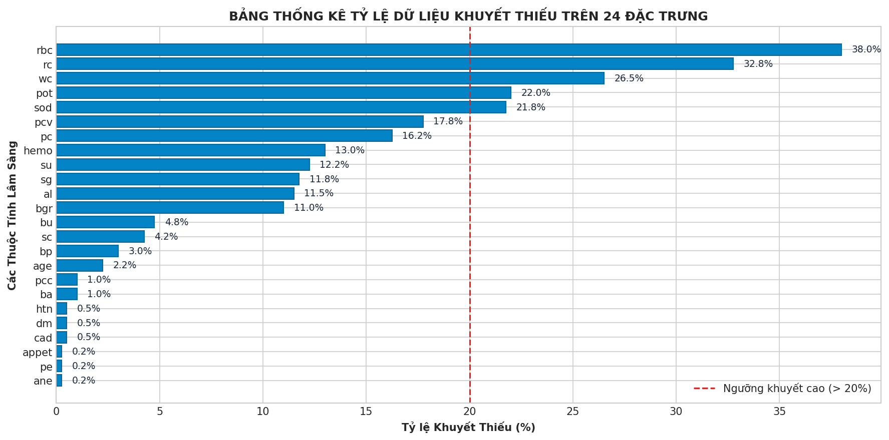
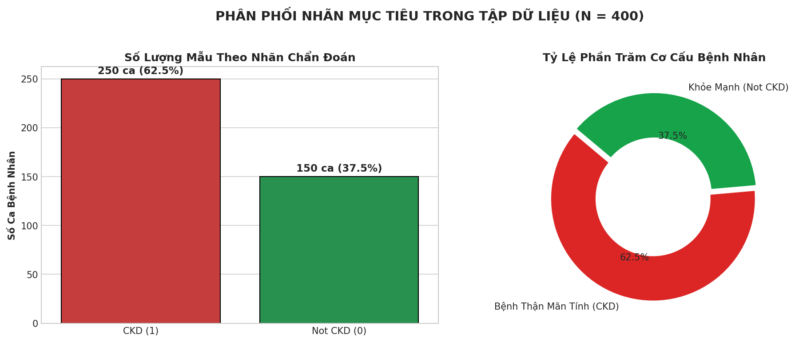
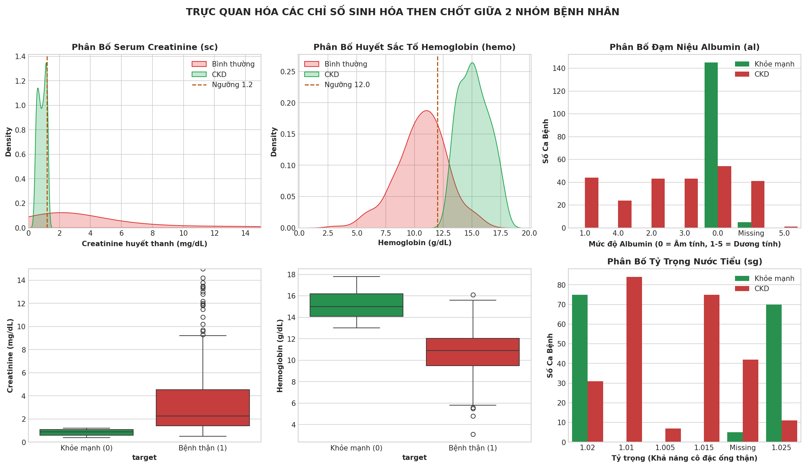
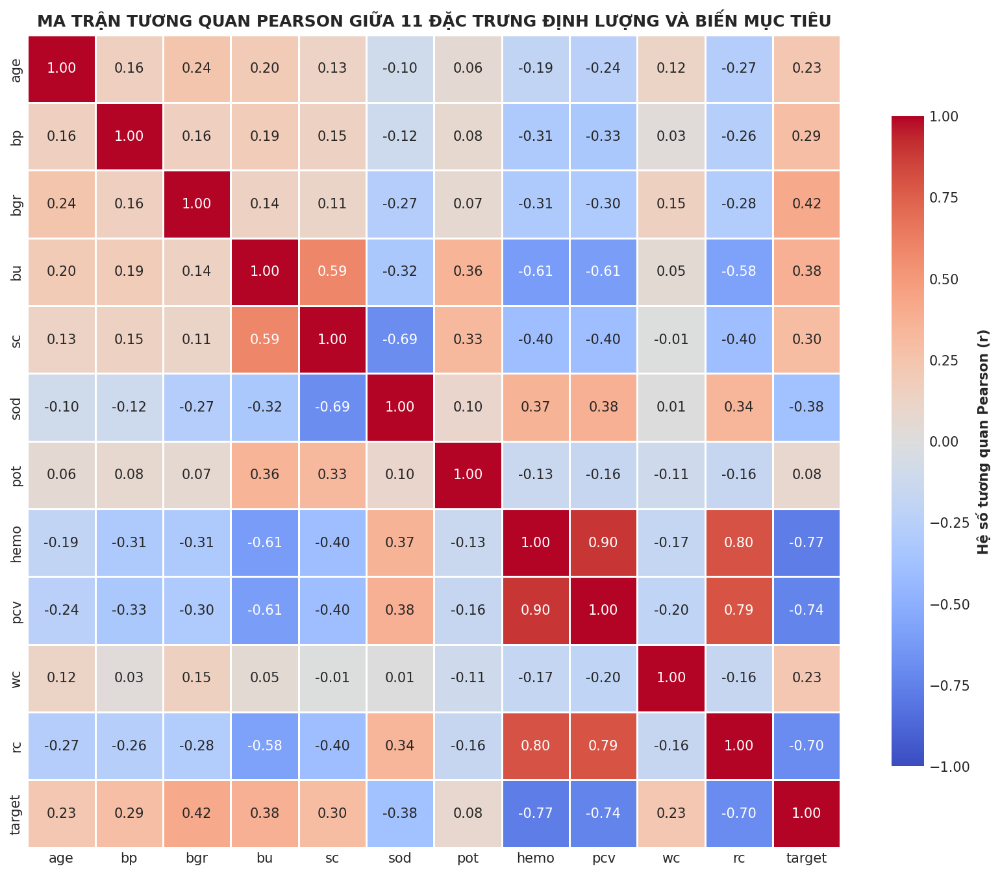

# BÁO CÁO TIẾN ĐỘ TUẦN 05 — TRỰC QUAN HÓA DỮ LIỆU & NHẬN XÉT ĐỊNH HƯỚNG TIỀN XỬ LÝ

- **Đề tài:** Đề tài số 04 — Hệ Thống Máy Học Hỗ Trợ Chẩn Đoán Bệnh Thận Mãn Tính (Chronic Kidney Disease — CKD)
- **Lớp:** `15DHKHDL04` — **GVHD:** ThS. Nguyễn Thị Huyền Trang
- **Giai đoạn:** Giai đoạn 1 (Tuần 4–5)
- **Liên hệ Rubric:** Thu thập dữ liệu, trực quan hóa dữ liệu — Phần trực quan hóa dữ liệu (PLO2 / CLO1 — Trọng số: 10% / Điểm: 1.0)
- **Thành viên chủ trì:** Triệu Thị Thu Ngân (`2405240179`)
- **Trạng thái:** Hoàn thành 100%

---

## 1. Nội Dung Công Việc Thực Hiện (Theo Yêu Cầu Kế Hoạch Tuần 5)
1. **Trực quan hóa dữ liệu đa biến:**
   - Phân tích và biểu diễn trực quan phân bố giá trị khuyết thiếu trên toàn bộ 24 đặc trưng.
   - Trực quan hóa tỷ lệ phân bố nhãn mục tiêu `classification`.
   - Phân tích chuyên sâu phân bố các chỉ số sinh hóa cốt lõi (*Golden Biomarkers*) theo từng nhóm bệnh nhân: Creatinine máu (`sc`), Hemoglobin (`hemo`), Albumin niệu (`al`), Tỷ trọng nước tiểu (`sg`).
   - Xây dựng ma trận tương quan Pearson Heatmap để phát hiện tương quan mạnh và hiện tượng đa cộng tuyến.
2. **Viết nhận xét ban đầu về đặc điểm dữ liệu và định hướng tiền xử lý:**
   - Phân tích ý nghĩa lâm sàng của các biểu đồ đã vẽ.
   - Đề xuất giải pháp kỹ thuật chính xác cho khâu tiền xử lý (Tuần 6) nhằm chuẩn bị cho việc xây dựng mô hình.

---

## 2. Kết Quả Trực Quan Hóa & Phát Hiện Chuyên Môn

### 2.1. Phân bố giá trị khuyết thiếu (`missing_values.png`)

- **Phát hiện:** Có 5 thuộc tính khuyết trên $20\%$ gồm: `rbc` (38.0%), `rc` (32.75%), `wc` (26.5%), `pot` (22.0%), `sod` (21.75%).
- **Nhận xét & Định hướng tiền xử lý:** Nếu loại bỏ dòng có giá trị khuyết (`dropna`), dữ liệu sẽ bị mất tới hơn 60% số ca bệnh. Do đó, **bắt buộc phải sử dụng phương pháp điền khuyết (Imputation)**: Dùng trung vị (Median) cho biến số để kháng ngoại lai và dùng yếu vị (Mode) cho biến phân loại.

### 2.2. Phân bố nhãn mục tiêu (`target_distribution.png`)

- **Phát hiện:** Tỷ lệ nhãn là 250 ca CKD (62.5%) so với 150 ca Not-CKD (37.5%).
- **Định hướng tiền xử lý:** Tỷ lệ này là mất cân bằng nhẹ ($1.67 : 1$), không cần thiết phải sinh mẫu nhân tạo (SMOTE) vì dễ làm sai lệch dữ liệu y tế; thay vào đó sử dụng **Stratified K-Fold / Stratified Split** để giữ nguyên tỷ lệ nhãn khi chia tập dữ liệu.

### 2.3. Phân tích chỉ số sinh hóa vàng (`golden_biomarkers.png`) kèm bảng dẫn chứng

- **Dẫn chứng định lượng (`groupby('target')`):** Nhóm Not CKD có `sc` median `0.90` (`0.40–1.20` mg/dL), `hemo` mean `15.19` g/dL, `bu` mean `32.80` mg/dL; trong khi nhóm CKD có `sc` mean `4.41` (median `2.25`, max `76.00` mg/dL), `hemo` tụt còn `10.65` g/dL và `bu` tăng vọt `72.39` mg/dL.
- **Dẫn chứng biến phân loại (`pd.crosstab normalize='index'`):** 100.00% các trường hợp `al >= 1.0`, `sg <= 1.015`, `htn = 'yes'` (`147/147`), `dm = 'yes'` (`137/137`), `pe = 'yes'` (`76/76`) và `ane = 'yes'` (`60/60`) đều mắc CKD.

### 2.4. Ma trận tương quan đa biến Heatmap (`correlation_matrix.png`) & `eda_summary`

- **Phát hiện:**
  - Tương quan âm mạnh nhất với nhãn CKD: `hemo` ($r = -0.769$), `pcv` ($r = -0.741$), `rc` ($r = -0.699$), `sod` ($r = -0.376$).
  - Tương quan dương mạnh với nhãn CKD: `bgr` ($r = +0.420$), `bu` ($r = +0.381$), `sc` ($r = +0.300$), `bp` ($r = +0.294$).
  - Cặp biến `hemo` và `pcv` có hiện tượng đa cộng tuyến nội tại rất cao ($r = +0.895$), cảnh báo thuật toán Naïve Bayes dễ vi phạm giả định độc lập.
  - **Tổng kết `eda_summary`:** `400` dòng, `24` đặc trưng (`11` số + `13` phân loại), `1,012 / 9,600` ô thiếu (`10.54%`), `0` dòng trùng lặp, `0` cột hằng số, `250` CKD (`62.50%`) / `150` Not-CKD (`37.50%`).

---

## 3. Sản Phẩm Cần Đạt & Mức Độ Hoàn Thành
- **Sản phẩm theo quy định:**
  - [x] Hệ thống biểu đồ trực quan hóa dữ liệu (histogram, boxplot, heatmap) chuẩn 150 DPI lưu tại `OutputForProject/MLOutput/`.
  - [x] Bản nhận xét sơ bộ về dữ liệu và đề xuất phương án tiền xử lý (lưu tại `word_demo/03_Chuong_3_Du_Lieu_Va_Tien_Xu_Ly.md`).
- **Kế hoạch Tuần 06 tiếp theo:** Cài đặt mã nguồn tiền xử lý dữ liệu (xử lý thiếu, mã hóa, chuẩn hóa, chia tập dữ liệu chống rò rỉ dữ liệu).
