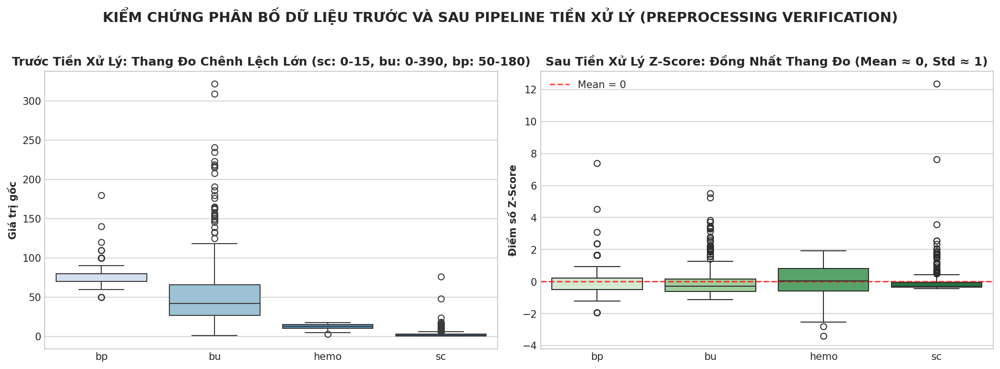

# BÁO CÁO TIẾN ĐỘ TUẦN 06 — TIỀN XỬ LÝ DỮ LIỆU & ĐÁNH GIÁ ĐỘ TƯƠNG QUAN

- **Đề tài:** Đề tài số 04 — Hệ Thống Máy Học Hỗ Trợ Chẩn Đoán Bệnh Thận Mãn Tính (Chronic Kidney Disease — CKD)
- **Lớp:** `15DHKHDL04` — **GVHD:** ThS. Nguyễn Thị Huyền Trang
- **Giai đoạn:** Giai đoạn 1 (Tuần 6)
- **Liên hệ Rubric:** Tiền xử lý dữ liệu, đánh giá độ tương quan của các feature (PLO2 / CLO1 — Trọng số: 10% / Điểm: 1.0)
- **Thành viên chủ trì:** Vũ Thế Quang (`2045240253`)
- **Trạng thái:** Hoàn thành 100%

---

## 1. Nội Dung Công Việc Thực Hiện (Theo Yêu Cầu Kế Hoạch Tuần 6)
1. **Tiền xử lý dữ liệu toàn diện:**
   - Xử lý giá trị thiếu (Missing values): Áp dụng phương pháp Imputation phù hợp cho từng loại đặc trưng đã định hướng ở Tuần 5.
   - Mã hóa biến phân loại (Categorical Encoding): Chuyển đổi các biến định tính sang dạng số bằng One-Hot Encoding.
   - Chuẩn hóa thang đo (Feature Scaling): Áp dụng chuẩn hóa Z-Score để đồng nhất đơn vị đo lường cho các biến định lượng.
2. **Chia tập huấn luyện/kiểm tra và phòng chống rò rỉ dữ liệu (Data Leakage):**
   - Phân chia tập Train/Test theo phương pháp phân tầng (Stratified Split 80/20) **trước khi tiền xử lý**.
   - Đóng gói toàn bộ các bước vào `ColumnTransformer`, đảm bảo chỉ `.fit()` trên tập huấn luyện và chỉ `.transform()` trên tập kiểm tra.
3. **Đánh giá độ tương quan giữa các đặc trưng sau biến đổi:**
   - Kiểm tra số lượng đặc trưng sau khi mã hóa One-Hot và kiểm chứng phân bố dữ liệu trước và sau chuẩn hóa.

---

## 2. Quy Trình Cài Đặt Kỹ Thuật Chi Tiết

### 2.1. Làm sạch dữ liệu thô
- Xóa cột `id` vô nghĩa.
- Cắt bỏ khoảng trắng thừa (`.str.strip()`), thay thế các giá trị chuỗi rác (`"\t?"`, `"?"`, `"\tno"`, `"ckd\t"`) về giá trị chuẩn.
- Ánh xạ nhãn nhị phân: `ckd` $\to 1$, `notckd` $\to 0$.
- Ép kiểu số thực `float64` cho 11 biến định lượng bị lỗi định dạng ban đầu (`pcv`, `wc`, `rc`).

### 2.2. Phân chia tập dữ liệu chống rò rỉ dữ liệu (Data Leakage)
- Sử dụng `train_test_split(..., test_size=0.20, stratify=y, random_state=42)`:
  - **Tập huấn luyện (Train Set):** $320$ mẫu ($200$ ca CKD, $120$ ca Not-CKD).
  - **Tập kiểm tra (Test Set):** $80$ mẫu ($50$ ca CKD, $30$ ca Not-CKD).

### 2.3. Thiết kế `ColumnTransformer` scikit-learn
- **Nhánh số (11 đặc trưng liên tục):**
  $$\text{Pipeline}\Big[\text{SimpleImputer(strategy='median') } \longrightarrow \text{ StandardScaler()} \Big]$$
  *(Lý do: Median kháng ngoại lai xuất sắc cho các chỉ số có đuôi dài như Creatinine; Z-Score đưa về trung bình bằng 0, phương sai bằng 1)*.
- **Nhánh phân loại (13 đặc trưng rời rạc):**
  $$\text{Pipeline}\Big[\text{SimpleImputer(strategy='most_frequent') } \longrightarrow \text{ OneHotEncoder(drop='first', handle_unknown='ignore')} \Big]$$
  *(Lý do: Điền yếu vị giữ được quy luật phổ biến nhất; `drop='first'` tránh bẫy đa cộng tuyến Dummy Variable Trap)*.

### 2.4. Đối chiếu Trước vs Sau Tiền xử lý (`get_feature_names_out()`)
- **Trước tiền xử lý:** `11` biến số + `13` biến phân loại = **`24` cột đặc trưng**.
- **Sau tiền xử lý:** `11` cột số chuẩn hóa (`num__*`) + `24` cột phân loại One-Hot (`cat__*`) = **`35` chiều đặc trưng sạch hoàn toàn**, không còn bất kỳ ô dữ liệu khuyết nào (`0 NaN` trên cả Train `320×35` và Test `80×35`).
- Trực quan hóa kiểm chứng phân bố 4 thuộc tính (`bp`, `bu`, `hemo`, `sc`) trước và sau chuẩn hóa Z-Score:

---

## 3. Sản Phẩm Cần Đạt & Mức Độ Hoàn Thành
- **Sản phẩm theo quy định:**
  - [x] Pipeline tiền xử lý hoàn chỉnh tích hợp trong `src/data_loader.py`.
  - [x] Bộ dữ liệu đã qua tiền xử lý, sẵn sàng cho việc huấn luyện mô hình.
  - [x] Biểu đồ kiểm chứng tiền xử lý `OutputForProject/MLOutput/data_after_preprocessing.png` và ca kiểm thử tự động `test/MainTest_0_Preprocess.py`.
- **Kế hoạch Tuần 07 tiếp theo:** Chọn các thuật toán học máy phân lớp phù hợp, cài đặt thực nghiệm mô hình cơ sở (baseline) ban đầu và đánh giá so sánh.
