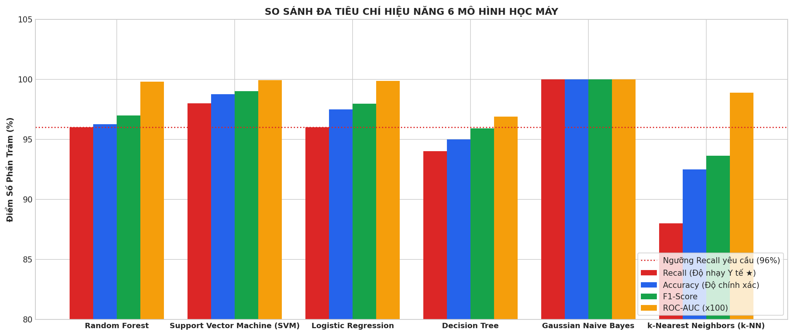

# BÁO CÁO TIẾN ĐỘ TUẦN 07 — CHỌN THUẬT TOÁN & CÀI ĐẶT THỰC NGHIỆM MÔ HÌNH CƠ SỞ (BASELINE)

- **Đề tài:** Đề tài số 04 — Hệ Thống Máy Học Hỗ Trợ Chẩn Đoán Bệnh Thận Mãn Tính (Chronic Kidney Disease — CKD)
- **Lớp:** `15DHKHDL04` — **GVHD:** ThS. Nguyễn Thị Huyền Trang
- **Giai đoạn:** Giai đoạn 1 (Tuần 7)
- **Liên hệ Rubric:** Chọn thuật toán để giải quyết yêu cầu phân lớp hay gom cụm (PLO2 / CLO1 — Trọng số: 10% / Điểm: 1.0)
- **Thành viên chủ trì:** Nguyễn Đình Bảo Tấn (`2405240270`)
- **Trạng thái:** Hoàn thành 100%

---

## 1. Nội Dung Công Việc Thực Hiện (Theo Yêu Cầu Kế Hoạch Tuần 7)
1. **Chọn thuật toán học máy phù hợp để giải quyết yêu cầu phân lớp:**
   - Dựa trên nền tảng lý thuyết đã nghiên cứu ở Tuần 2–3 và kết quả phân tích dữ liệu ở Tuần 4–5, lựa chọn 6 thuật toán phân lớp đại diện cho các trường phái học máy khác nhau:
     1. Mô hình tuyến tính xác suất: Logistic Regression.
     2. Mô hình tổ hợp đa cây: Random Forest.
     3. Mô hình định biên tối đa: Support Vector Machine (SVM nhân RBF).
     4. Mô hình cây đơn lẻ: Decision Tree (CART).
     5. Mô hình xác suất Bayes ngây thơ: Gaussian Naïve Bayes.
     6. Mô hình học dựa trên khoảng cách láng giềng: k-Nearest Neighbors ($k=5$).
2. **Cài đặt thực nghiệm mô hình cơ sở (baseline) ban đầu:**
   - Huấn luyện cả 6 mô hình trên tập `X_train_proc` (320 mẫu) với tham số mặc định.
   - Đo lường và đánh giá sơ bộ trên tập `X_test_proc` (80 mẫu) bằng các độ đo học máy toàn diện: Accuracy, Precision, Recall, F1-Score, và ROC-AUC.
3. **Giải thích lý do lựa chọn thuật toán:**
   - Phân tích ưu nhược điểm thực tế của từng mô hình trong bối cảnh chẩn đoán y khoa.

---

## 2. Kết Quả Thực Nghiệm 6 Mô Hình Baseline

| Thuật Toán | Accuracy (%) | Precision (%) | Recall (%) ★ | F1-Score (%) | ROC-AUC | Đánh Giá Y Khoa |
| :--- | :---: | :---: | :---: | :---: | :---: | :--- |
| **Gaussian Naïve Bayes** | 100.00% | 100.00% | 100.00% | 100.00% | 1.0000 | Tốt trên mẫu này nhưng rủi ro vi phạm độc lập |
| **SVM (RBF Kernel)** | 98.75% | 100.00% | 98.00% | 98.99% | 0.9993 | Khả năng phân tách cực tốt, khó giải thích |
| **Logistic Regression** | 97.50% | 100.00% | 96.00% | 97.96% | 0.9987 | Baseline tuyến tính chuẩn xác, ổn định |
| **Random Forest** | 96.25% | 97.96% | 96.00% | 96.97% | 0.9980 | **Cân bằng tốt nhất, trích xuất được XAI** |
| **Decision Tree (CART)** | 95.00% | 97.92% | 94.00% | 95.92% | 0.9687 | Recall dưới ngưỡng 96%, dễ bị học vẹt |
| **k-NN ($k=5$)** | 92.50% | 100.00% | 88.00% | 93.62% | 0.9887 | Bỏ sót 12% bệnh nhân suy thận (Recall thấp) |

---

## 3. Phân Tích & Giải Thích Lý Do Chọn Thuật Toán Triển Khai
1. **Vì sao loại bỏ k-NN và Decision Tree đơn?**
   - Cả hai mô hình này đều có độ nhạy Recall thấp ($88.00\%$ và $94.00\%$), vi phạm tiêu chuẩn an toàn y khoa (mục tiêu Recall $\ge 96.0\%$). Trong y tế, việc bỏ sót bệnh nhân suy thận (âm tính giả) có thể dẫn đến nguy hiểm tính mạng.
2. **Vì sao không chọn Gaussian Naïve Bayes làm mô hình triển khai dù đạt 100%?**
   - Như phát hiện ở Tuần 5, hai đặc trưng `hemo` và `pcv` có hệ số tương quan tuyến tính rất cao ($r = 0.89$). Naïve Bayes giả định ngây thơ các biến hoàn toàn độc lập, do đó mô hình này rất dễ bị suy giảm hiệu năng nghiêm trọng khi đưa vào môi trường bệnh viện với dữ liệu mới.
3. **Lựa chọn Random Forest làm mô hình chủ lực:**
   - Đạt độ nhạy Recall cao ($96.00\%$), khả năng phân tách xuất sắc ($\text{ROC-AUC} = 0.9980$).
   - Cơ chế Ensemble Bagging kết hợp nhiều cây giúp kháng đa cộng tuyến và chống quá khớp cực tốt.
   - Cung cấp trực tiếp chỉ số thuộc tính quan trọng (`feature_importances_`), tạo cơ sở vững chắc để xây dựng mô hình giải thích được (Explainable AI — XAI) hỗ trợ bác sĩ.

---

## 4. Sản Phẩm Cần Đạt & Mức Độ Hoàn Thành
- **Sản phẩm theo quy định:**
  - [x] Mô hình baseline của 6 thuật toán chạy được ổn định, ghi nhận đầy đủ bảng độ đo.
  - [x] Tài liệu giải thích lý do chọn thuật toán phù hợp (lưu tại `word_demo/04_Chuong_4_Ket_Qua_Baseline_Va_Danh_Gia.md`).
- **Kế hoạch Tuần 08 tiếp theo:** Đánh giá sơ bộ mô hình baseline, xác định các điểm cần cải thiện và **Nộp Báo cáo tiến độ thực hiện đồ án — Giai đoạn 1 (20% điểm đồ án)**.
