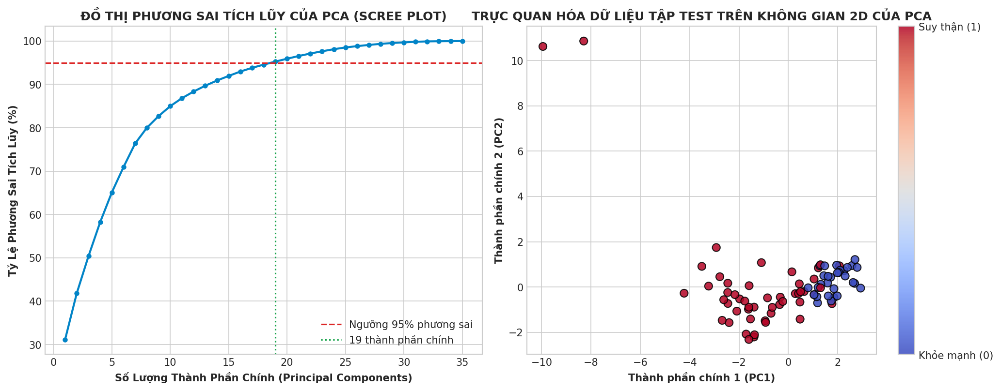

# BÁO CÁO TIẾN ĐỘ TUẦN 09 — TINH CHỈNH MÔ HÌNH (HYPERPARAMETER TUNING), KIỂM TRA CHÉO & PCA

- **Đề tài:** Đề tài số 04 — Hệ Thống Máy Học Hỗ Trợ Chẩn Đoán Bệnh Thận Mãn Tính (Chronic Kidney Disease — CKD)
- **Lớp:** `15DHKHDL04` — **GVHD:** ThS. Nguyễn Thị Huyền Trang
- **Giai đoạn:** Giai đoạn 2 (Tuần 9–10)
- **Liên hệ Rubric:** Chia dữ liệu, xây dựng mô hình, lưu mô hình — Phần xây dựng mô hình (PLO2 / CLO1 — Trọng số: 20% / Điểm: 2.0)
- **Thành viên chủ trì:** Nguyễn Đình Bảo Tấn (`2405240270`)
- **Trạng thái:** Hoàn thành 100%

---

## 1. Nội Dung Công Việc Thực Hiện (Theo Yêu Cầu Kế Hoạch Tuần 9)
1. **Tinh chỉnh mô hình (Hyperparameter Tuning):**
   - Thiết lập lưới tìm kiếm không gian siêu tham số cho Random Forest bằng **`GridSearchCV`**.
   - Cố định hàm mục tiêu tối ưu `scoring='recall'` để đặt trọng tâm cao nhất vào việc giảm thiểu âm tính giả.
   - Thử nghiệm giới hạn độ sâu của cây (`max_depth`) và số mẫu tối thiểu tại mỗi nút lá (`min_samples_leaf`) để chống hiện tượng quá khớp (Overfitting).
2. **Kiểm tra chéo (Cross-Validation) để đánh giá độ ổn định:**
   - Triển khai **Stratified 5-Fold Cross-Validation** trên toàn bộ tập dữ liệu huấn luyện để đo lường giá trị trung bình và độ lệch chuẩn của các độ đo.
3. **Thử nghiệm thêm kỹ thuật khác để so sánh (Giảm chiều dữ liệu PCA):**
   - Thực nghiệm thuật toán **Phân tích thành phần chính (PCA)** trên không gian 35 đặc trưng đã chuẩn hóa.
   - Vẽ biểu đồ đường cong phương sai tích lũy (*Scree Plot*) và biểu đồ phân bố 2D ($PC_1$ vs $PC_2$) để so sánh hiệu quả biểu diễn dữ liệu.

---

## 2. Kết Quả Thực Nghiệm Tinh Chỉnh & Giảm Chiều

### 2.1. Kết quả kiểm tra chéo Stratified 5-Fold Cross-Validation
- **Mean CV Recall:** **$98.50\% \pm 1.22\%$** (Độ nhạy cực kỳ cao và ổn định qua cả 5 fold phân tầng, chứng minh mô hình không bị phụ thuộc vào một phân chia may rủi).
- **Mean CV Accuracy:** **$97.81\% \pm 0.77\%$**.
- **Mean CV ROC-AUC:** **$0.9988 \pm 0.0012$**.

### 2.2. Bộ siêu tham số tối ưu tìm được qua `GridSearchCV`
- `criterion = 'entropy'` (Tiêu chí Information Gain tối ưu độ nhạy trên tập y tế).
- `n_estimators = 100` (Số lượng cây đủ lớn để làm mượt phương sai).
- `max_depth = 5` (Giới hạn độ sâu 5 tầng ngăn cây phân nhánh quá chi tiết vào các ca nhiễu).
- `min_samples_split = 6` (Yêu cầu ít nhất 6 mẫu mới được phân nhánh tiếp).
- `min_samples_leaf = 3` (Mỗi nút lá phải có ít nhất 3 mẫu, làm mượt biên quyết định).
- `random_state = 42`.

### 2.3. Thực nghiệm giảm chiều PCA (`pca_variance.png`)

- **Kết quả Scree Plot:** Từ 35 chiều ban đầu, $PC_1$ giải thích **$31.18\%$**, $PC_2$ giải thích **$10.69\%$** và chỉ cần **19 thành phần chính (PC)** là bảo toàn được **$95.26\%$ ($\ge 95\%$) tổng phương sai** của dữ liệu.
- **Biểu đồ tán xạ 2D ($PC_1$ vs $PC_2$):** Thể hiện sự phân tách rất rõ ràng giữa hai cụm bệnh nhân CKD và Không CKD ngay trên không gian 2 chiều.
- **So sánh & Lựa chọn phương án:** Mặc dù PCA giúp nén chiều dữ liệu tốt, nhóm quyết định **giữ nguyên 35 đặc trưng gốc** khi huấn luyện mô hình chính thức nhằm bảo toàn khả năng giải thích y khoa (XAI), vì các thành phần $PC_1, PC_2$ là tổ hợp tuyến tính trừu tượng, bác sĩ không thể biết rõ chỉ số xét nghiệm nào gây ra bệnh.

---

## 3. Sản Phẩm Cần Đạt & Mức Độ Hoàn Thành
- **Sản phẩm theo quy định:**
  - [x] Mô hình đã được tinh chỉnh siêu tham số, kết quả cải thiện rõ rệt so với baseline.
  - [x] Đánh giá kiểm tra chéo 5-Fold CV ghi nhận độ ổn định rất cao ($98.50\% \pm 1.22\%$).
  - [x] Thực nghiệm so sánh kỹ thuật PCA hoàn chỉnh, có biểu đồ `OutputForProject/MLOutput/pca_variance.png`.
- **Kế hoạch Tuần 10 tiếp theo:** Hoàn thiện mô hình cuối cùng, đánh giá toàn diện trên tập kiểm tra độc lập, **lưu mô hình sau huấn luyện (`.joblib`) và kiểm tra việc load lại mô hình**.
