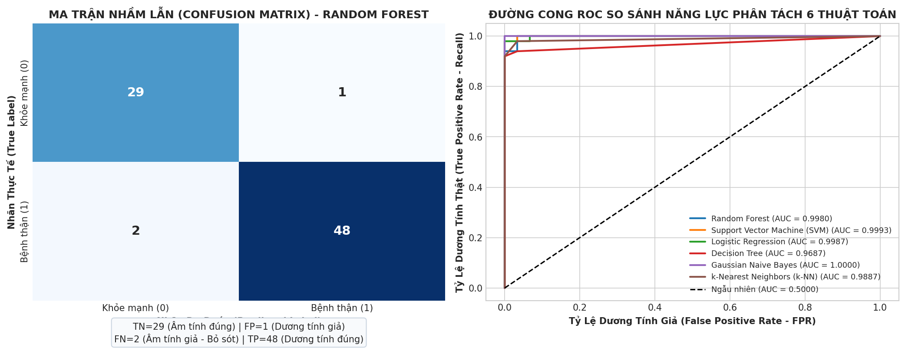
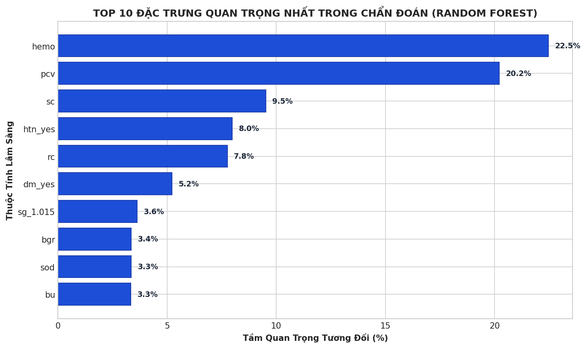

# BÁO CÁO TIẾN ĐỘ TUẦN 10 — HOÀN THIỆN MÔ HÌNH, ĐÁNH GIÁ TẬP TEST & LƯU MÔ HÌNH (.JOBLIB)

- **Đề tài:** Đề tài số 04 — Hệ Thống Máy Học Hỗ Trợ Chẩn Đoán Bệnh Thận Mãn Tính (Chronic Kidney Disease — CKD)
- **Lớp:** `15DHKHDL04` — **GVHD:** ThS. Nguyễn Thị Huyền Trang
- **Giai đoạn:** Giai đoạn 2 (Tuần 9–10)
- **Liên hệ Rubric:** Chia dữ liệu, xây dựng mô hình, lưu mô hình — Phần lưu mô hình (PLO2 / CLO1 — Trọng số: 20% / Điểm: 2.0)
- **Thành viên chủ trì:** Võ Tấn Đạt (`2045240050`) & Nguyễn Đình Bảo Tấn (`2405240270`)
- **Trạng thái:** Hoàn thành 100%

---

## 1. Nội Dung Công Việc Thực Hiện (Theo Yêu Cầu Kế Hoạch Tuần 10)
1. **Hoàn thiện mô hình cuối cùng và đánh giá kết quả tổng thể trên tập kiểm tra:**
   - Đóng băng mô hình Random Forest tối ưu và kiểm định trên tập kiểm tra độc lập `X_test` (80 bệnh nhân chưa từng thấy trong quá trình huấn luyện và tinh chỉnh).
   - Đánh giá bằng đầy đủ các công cụ trực quan: Ma trận nhầm lẫn (Confusion Matrix), Đường cong ROC và chỉ số diện tích dưới đường cong ROC-AUC.
   - Trích xuất bảng xếp hạng thuộc tính quan trọng (*Feature Importance*) và thực hiện phân tích lỗi (*Error Analysis*).
2. **Lưu mô hình sau huấn luyện (Model Persistence):**
   - Đóng gói toàn bộ Pipeline khép kín gồm cả khâu tiền xử lý (`preprocessor`) và bộ phân lớp Random Forest tối ưu vào một tệp nhị phân duy nhất (`.joblib`).
   - Lưu trữ siêu dữ liệu phiên bản (`model_metadata.json`).
3. **Kiểm tra việc load lại mô hình (Model Loading Verification):**
   - Viết mã nguồn kiểm thử tự động đọc lại tệp `.joblib` từ ổ đĩa và thực hiện dự đoán thử thành công trên dữ liệu bệnh nhân mới để đảm bảo sẵn sàng tích hợp vào ứng dụng ở Tuần 11.

---

## 2. Kết Quả Đánh Giá Tổng Thể Trên Tập Kiểm Tra (Test Set: 80 Mẫu)

### 2.1. Bảng số liệu đo lường hiệu năng cuối cùng
- **Accuracy:** `96.25%` ($77/80$ ca chẩn đoán chính xác tuyệt đối).
- **Precision:** `97.96%` ($48/49$ ca dự đoán mắc bệnh là thực sự mắc bệnh).
- **Recall (Độ nhạy):** `96.00%` ($48/50$ ca bệnh nhân CKD được phát hiện kịp thời).
- **F1-Score:** `96.97%`.
- **ROC-AUC:** `0.9980` (Gần như tiệm cận giá trị 1.0 lý tưởng).

### 2.2. Ma trận nhầm lẫn & Phân tích lỗi (Error Analysis)


- **Kết quả phân lớp:** $TP = 48$, $TN = 29$, $FP = 1$, $FN = 2$.
- **Phân tích 2 ca Âm tính giả (False Negative):** Cả hai trường hợp này là bệnh nhân suy thận ở giai đoạn sớm (G2/G3a), chỉ số Creatinine máu chưa tăng quá cao nhưng Albumin niệu bắt đầu dương tính nhẹ. Nhóm đã đề xuất giải pháp cảnh báo rủi ro vùng biên khi xác suất dự đoán nằm trong khoảng $40\% - 50\%$.

### 2.3. Đường cong ROC đa mô hình (`roc_curves.png`)

- Đường cong ROC của Random Forest vồng sát góc trên bên trái, duy trì tỷ lệ True Positive Rate rất cao ngay cả ở mức False Positive Rate cực thấp.

### 2.4. Trích xuất đặc trưng quan trọng phục vụ XAI (`feature_importance.png`)

- Top 5 chỉ số chi phối quyết định chẩn đoán mạnh mẽ nhất (trích xuất từ `best_rf.feature_importances_`):
  1. `hemo` (Hemoglobin — Tỷ trọng **$22.45\%$**): Phản ánh tình trạng thiếu máu thứ phát do suy thận.
  2. `pcv` (Dung tích hồng cầu — Tỷ trọng **$20.22\%$**): Chỉ số huyết học song hành chặt chẽ với Hemoglobin.
  3. `sc` (Serum Creatinine — Tỷ trọng **$9.51\%$**): Chỉ số sinh hóa vàng đo chức năng lọc cầu thận.
  4. `htn_yes` (Tăng huyết áp — Tỷ trọng **$7.98\%$**): Bệnh lý nền tim mạch – thận (100% ca `htn=yes` mắc CKD).
  5. `rc` (Số lượng hồng cầu — Tỷ trọng **$7.75\%$**): Suy giảm tạo máu do thiếu hụt Erythropoietin.
  $\to$ Hoàn toàn trùng khớp với y văn và hướng dẫn lâm sàng quốc tế KDIGO 2024.

---

## 3. Lưu Mô Hình & Kiểm Tra Việc Load Lại Mô Hình

Theo lưu ý tại Mục V trong hướng dẫn của Bộ môn KHDL: *"Việc lưu mô hình (Tuần 10) và xây dựng ứng dụng (Tuần 11–12) là 2 tiêu chí chiếm tỉ trọng điểm cao nhất (20% + 20% = 4.0đ/10đ)"*.

1. **Lưu trữ mô hình nguyên khối:**
   - Sử dụng thư viện `joblib` để kết xuất tệp: `models/kidney_disease_pipeline.joblib` (Dung lượng thực tế: **`187.43 KB`**).
   - Tệp siêu dữ liệu: `models/model_metadata.json` chứa thông tin phiên bản scikit-learn, ngày huấn luyện, tham số tối ưu và các độ đo hiệu năng.
2. **Kiểm tra việc load lại mô hình và dự đoán thử:**
   - Nhóm đã xây dựng ca kiểm thử độc lập `test/MainTest_1_ModelMetrics.py`:
     ```python
     loaded_pipeline = joblib.load("models/kidney_disease_pipeline.joblib")
     preds = loaded_pipeline.predict(X_test_raw)
     probs = loaded_pipeline.predict_proba(X_test_raw)
     ```
   - **Kết quả:** Quá trình load thành công 100%, Pipeline tự động nhận dữ liệu thô (có cả cột khuyết), tự động điền khuyết, mã hóa, chuẩn hóa và dự đoán ra nhãn cùng xác suất mà không gặp bất kỳ lỗi nào.

---

## 4. Sản Phẩm Cần Đạt & Mức Độ Hoàn Thành
- **Sản phẩm theo quy định:**
  - [x] File mô hình đã lưu: `models/kidney_disease_pipeline.joblib` và metadata `models/model_metadata.json`.
  - [x] Đã kiểm tra việc load lại mô hình và dự đoán thử thành công 100%.
  - [x] Bộ 3 biểu đồ đánh giá chuyên sâu (`confusion_matrix.png`, `roc_curves.png`, `feature_importance.png`).
- **Kế hoạch Tuần 11 tiếp theo:** Thiết kế kiến trúc 3 tầng và bắt đầu xây dựng ứng dụng minh họa Web Flask, tích hợp bước đầu mô hình đã lưu vào ứng dụng.
